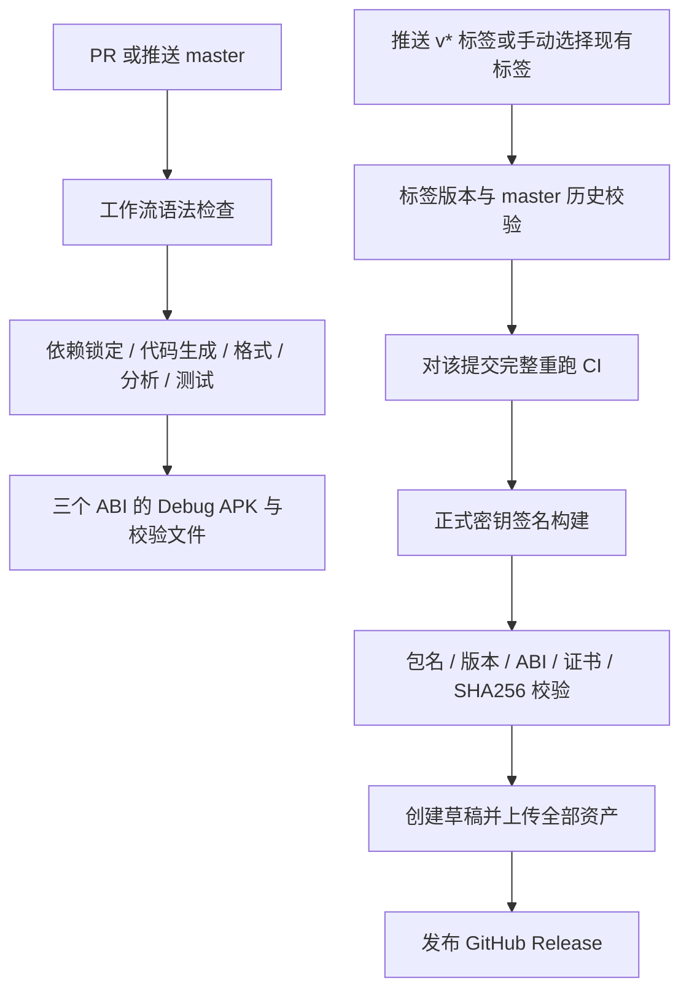

# CI/CD：GitHub Actions 与 Android APK 发布

日期：2026-10-25。仓库 `Brokenheart100/BlibiliTV`，默认分支 `master`；仓库 ID 与原 `Brokenheart100/mambatv` 相同，本地远端已更新为新地址。应用与工作流提交 `c7f0c9226376e49c083f15af17daa9a47936a5f9` 的[首次托管 CI](https://github.com/Brokenheart100/BlibiliTV/actions/runs/40179970843)已通过：工作流检查、质量检查和 Android APK 构建全部成功，覆盖率与三架构 Debug APK 已上传。本次没有创建 tag 或 Release；自动打包不等同于 M7 真机／正式发布验收。验证结果见 [ci-cd-validation.json](ci-cd-validation.json)。

## 流程与触发



| 入口 | 行为 | 签名／写权限 |
| --- | --- | --- |
| 任意 PR，包括 fork | actionlint、流水线守卫测试、Flutter 检查与 Debug APK | 无发布密钥，仓库只读 |
| 推送 `master` | 同上，生成可下载的 Actions artifacts | 仓库只读 |
| 手动运行 CI | 检查当前选择的提交 | 仓库只读 |
| 推送 `v*` tag | 检查既有 tag 与版本；完整 CI 后签名并发布 | 构建步骤读取签名 Secrets；仅发布 job 为 contents:write |
| 手动 Release Android | 从 `master` 发起，填写已存在的 tag；不创建 tag | 与 tag 发布相同 |

工作流：[CI](../.github/workflows/ci.yml)、[Release Android](../.github/workflows/release-android.yml)。复用同一个 CI，通过预检输出的确切提交 SHA 构建；手动发布也不会误用当前分支代码。tag 指向的提交必须属于 `origin/master` 历史。

同一个 PR 的旧运行自动取消；发布按 tag 串行，不取消正在签名／上传的运行。发布不覆盖已有 Release；若上传中断留下草稿，先检查并处理草稿再重跑，流水线不会自动删除或替换历史安装包。

## 工具链与检查

唯一工具链清单是 [toolchain.json](../tool/ci/toolchain.json)：Flutter 3.47.5 stable、框架修订 `6a19cca56475dbfba1478ee68d7bd0c2ef891da1`、Dart 3.13.4、Temurin JDK 21、Android API 36、Build Tools 36.0.0、NDK 28.2.13676358；Gradle 9.3.1 使用官方分发 SHA256。官方 stable 的框架修订与本机自定义分支所指提交一致。Windows 本地构建使用 JDK 25；Ubuntu 24.04／Temurin 21 的托管构建也已单独通过，并非用本机结果代替。

直接引用的 Actions 固定完整提交 SHA，版本注释用于人工升级。Flutter／Pub／Gradle 使用缓存，Gradle 仅允许 `master` 写缓存；依赖仍通过 `flutter pub get --enforce-lockfile` 校验，不以缓存代替锁文件。

检查顺序：

1. actionlint 1.7.12 验证工作流；Python 标准库测试验证发布守卫。
2. 还原锁定依赖，运行 `build_runner`。已有生成文件出现 diff 或新增生成文件未提交即失败，覆盖 Riverpod、Freezed、JSON 与 Drift。
3. `dart format --output=none --set-exit-if-changed`、`flutter analyze --fatal-infos`、`flutter test --coverage`。
4. 从默认产品入口 `lib/main.dart` 构建拆分 Debug APK，校验产物；覆盖率保留 14 天，Debug APK artifacts 保留 14 天。

Flutter 会在干净检出时补充被模板忽略的 Gradle wrapper 脚本／jar；不在工作流提前对不存在的 `android/gradlew` 执行 chmod。Gradle 分发校验和已写入 wrapper properties，setup-gradle 同时检查已存在的 wrapper jar。

默认 CI 不访问 B 站账号、不扫码、不读取本机安全凭据，也不运行依赖外部媒体和人工听感的 30 分钟 TV 测试。M5 的模拟器与人工边界继续见 [M5 验收](m5-validation.md)，真实 TV／ARM、2 小时稳定性和签名升级验收仍按 M7 执行。

## 配置正式签名

当前仓库没有签名 Secrets，配置本身不会生成或上传正式密钥。GitHub 仓库 Settings → Secrets and variables → Actions 添加：

| Secret | 内容 |
| --- | --- |
| `ANDROID_KEYSTORE_BASE64` | 正式 JKS／PKCS12 文件的 Base64 内容 |
| `ANDROID_KEYSTORE_PASSWORD` | 密钥库密码 |
| `ANDROID_KEY_ALIAS` | 用于发布的 alias |
| `ANDROID_KEY_PASSWORD` | 对应私钥密码 |

已经有发布密钥就继续使用；不要为每次构建重新生成。后续安装升级需要保持签名身份一致。若尚无密钥，可以自行执行 keytool 并交互输入密码，路径应在仓库之外：

```powershell
keytool -genkeypair -keystore D:\private-keys\mambatv-release.jks -alias mambatv -keyalg RSA -keysize 4096 -validity 10000
[Convert]::ToBase64String([IO.File]::ReadAllBytes('D:\private-keys\mambatv-release.jks')) | gh secret set ANDROID_KEYSTORE_BASE64 --repo Brokenheart100/BlibiliTV
gh secret set ANDROID_KEYSTORE_PASSWORD --repo Brokenheart100/BlibiliTV
gh secret set ANDROID_KEY_ALIAS --repo Brokenheart100/BlibiliTV
gh secret set ANDROID_KEY_PASSWORD --repo Brokenheart100/BlibiliTV
```

后三条命令交互录入值，不把密码写到命令历史或文档。Base64 是编码，仍须按秘密保管。CI 将密钥独占写入 runner 临时目录，仅向 Gradle 构建步骤注入必要环境变量，`always()` 清理临时密钥；产物只上传 APK、公开证书指纹和构建说明。

本地正式签名可复制 [key.properties.example](../android/key.properties.example) 为被忽略的 `android/key.properties`，或设置 `MAMBA_KEYSTORE_PATH`、`MAMBA_KEYSTORE_PASSWORD`、`MAMBA_KEY_ALIAS`、`MAMBA_KEY_PASSWORD`。相对 storeFile 路径以 `android/` 为基准，Windows 建议使用 `/`。

缺少／不完整签名配置、密钥不存在、错误密码会使 Release 失败；不回退到 Debug key。校验脚本还拒绝 Debug 证书、Debug 标志、验证包 ID、缺少 TV 启动入口、错误 ABI 和三份 APK 证书不一致。Debug／profile 构建不需要正式密钥。已有 Debug 安装与正式 Release 通常不是同一证书，不能把二者视为可直接覆盖升级；流水线不会替用户卸载应用或删除观看记录。

## 版本与首次运行

当前 `pubspec.yaml` 是 `1.0.0+1`，对应 tag 为 **`v1.0.0`**；`+1` 是基础 versionCode。支持 `1.0.1-rc.1+2` 对应 `v1.0.1-rc.1`，此类版本自动标为 prerelease。拆分 APK 的实际 versionCode 由 Flutter 按 ABI 生成，逐包记录在构建信息中，不伪称它们都等于基础 buildNumber。

首次应用提交已包含 M5、HTTP 缓存、生成代码和 CI 配置，并已通过托管 CI。后续版本同样应先提交推送完整代码，不能只推送一个脱离应用代码的版本标签。正式发布前配置上述签名 Secrets，并由维护者推送版本标签。例如确认当前版本就是要发布的版本后：

```powershell
git push origin master
git tag -a v1.0.0 -m 'MambaTV v1.0.0'
git push origin refs/tags/v1.0.0
```

这些是维护者后续发布命令，本次配置不会执行它们。仅在本地创建 tag 不触发 CD；普通分支 push 只做 CI。使用完整 `refs/tags/...` 避免同名分支造成歧义。版本不符、tag 不存在或不属于 master 历史都会在预检阶段失败。GitHub Actions 页面可手动运行 `Release Android` 并填写已有 tag，以复测失败运行。

## 产物与校验

- `mambatv-<version>+<build>-arm64-v8a-release.apk`
- `mambatv-<version>+<build>-armeabi-v7a-release.apk`
- `mambatv-<version>+<build>-x86_64-release.apk`
- `SHA256SUMS`、`build-metadata.json`、`release-notes.md`

ARM64／ARM32 对应目标电视或盒子架构；x86_64 供模拟器。先通过 aapt 和 apksigner 校验，再计算所有上传文件的 SHA256；发布 job 下载同一次运行的签名 artifacts 后再次核验校验和。构建信息记录提交、版本、工具链清单、实际构建宿主／Java、锁文件 SHA256、ABI、实际 versionCode 和公开证书指纹；托管 CI 构建若修改来源文件则拒绝产物。签名 artifacts 保留 30 天，成功后在 GitHub Release 发布。

本机 Release 验证使用一次性测试密钥，验证结束删除，不作为用户下载／升级渠道；不会用它写入仓库 Secrets 或发布 Release。托管 Debug 构建、APK 校验及产物上传已通过；正式密钥、首次真实签名发布和签名升级仍需另行验证。

## 官方依据

- [Flutter SDK archive](https://docs.flutter.dev/install/archive) 与 [flutter-action](https://github.com/subosito/flutter-action)：固定 SDK 版本与修订。
- [Flutter Android 签名与 APK 构建](https://docs.flutter.dev/deployment/android)：本地签名配置、拆分 ABI 与升级边界。
- [GitHub 可复用工作流](https://docs.github.com/en/actions/how-tos/reuse-automations/reuse-workflows)：同一 CI 检查用于发布提交。
- [upload-artifact](https://github.com/actions/upload-artifact)、[setup-gradle](https://github.com/gradle/actions/tree/main/setup-gradle) 和 [gh release create](https://cli.github.com/manual/gh_release_create)：产物、缓存和草稿发布接口。
