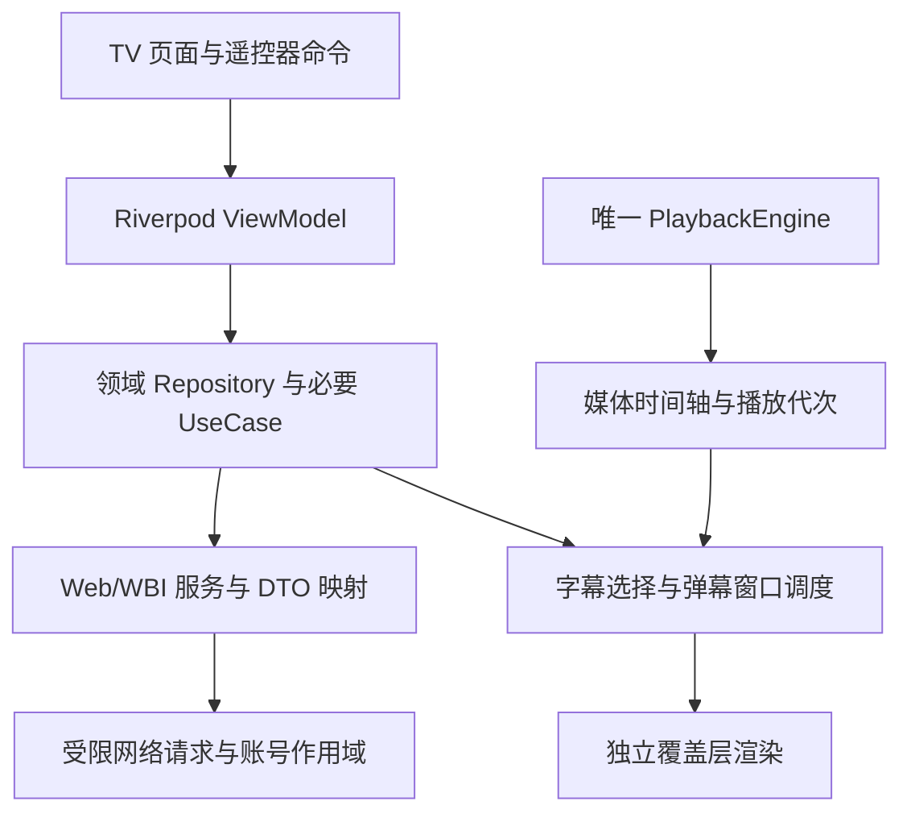

# MambaTV：TV 端 B 站客户端详细开发计划

2026-10-29 播放后端清理：用户确认移除 media_kit；所有入口统一 Better Player，Android 仍使用 Media3。旧构建回退和 mpv 专用实验工具删除，仍有用的集成测试迁到当前后端。Windows Better Player 本身需外部 libmpv DLL，详见 [清理与验证](media-backend-cleanup.md)。

2026-10-29 详情增量：视频“接着发现”改为纵向网格并自动续载；首页／搜索／我的 Tabs 点击刷新首屏；番剧按参考图改为封面资料区、真实统计、分组选集网格和配音／制作区。用户确认长短评后续再做，见 [详情记录](detail-layout-and-refresh.md)。

2026-10-29 搜索增量：扩展现有搜索的番剧／影视／直播类型，与视频共用胶囊 Tabs；首页／我的／搜索 Tabs 和侧栏统一玻璃效果。状态隔离、协议和验证见 [搜索记录](search-types-and-glass.md)。影视索引完整分类与直播推荐 -352 问题仍单列，不以关键词搜索代替这些验收。

日期：2026-10-26。状态：M6／M7 已随提交 `7eef332` 推送，[v1.0.0](https://github.com/Brokenheart100/BlibiliTV/releases/tag/v1.0.0) 正式签名发布成功；托管 CI 通过 179 项 Flutter 测试与 13 项流水线守卫。M7 按用户要求完成 15 分钟 profile、20 次进出与自动下一 P；真实 TV、人工音画与真实账号写入仍待验收，avsync 波动保留记录。M8 必交功能已实现，本机和真实账号只读验证通过，但持续弹幕性能未通过，M8 尚未完成验收；M9 核心已实现，原生回归与未验收项见 [M9 记录](m9-validation.md)。详细范围和完成标准已并入下文第 11 节，设计边界见 [ADR 0009](adr/0009-m8-m9-roadmap-and-feature-boundaries.md)。各阶段历史证据保留于 [M7](m7-validation.md)、[M6](m6-validation.md)、[M5](m5-validation.md)。

架构依据：[设计原则与架构](tv-bilibili-architecture.md)。主平台为 Android TV，使用 Flutter + Riverpod + MVVM + 整洁架构。

2026-10-29 界面增量：Cue 0.4.0 用于焦点、胶囊 Tabs 和局部进入动效；番剧成为侧栏独立分支，海报按实测原图使用 3:4 与保比例解码，历史记录保留第二位。实施及验证见 [界面记录](cue-tv-ui.md)，不代替 M8 弹幕性能或物理设备验收。

2026-10-27 播放增量：按用户要求，Android 默认试用 Better Player／Media3，保留 PlaybackEngine、既有 TV 控制和 media_kit 构建时回退。真实游客视频、缓冲与前后跳转已做专项模拟器验证；人工跳转杂音、口型同步与 ARM／物理电视验收单列待补，历史 M5–M7 长时结果不自动适用于新后端。详见 [试用记录](better-player-trial.md)。

## 1. 执行策略与发布范围

先把技术风险验证清楚，再按功能纵向交付。每个功能依次完成领域契约、服务与 Repository、必要 UseCase、Riverpod ViewModel、Consumer TV View 和验证，避免先做满模拟页面再集中接接口。ViewModel 使用 Notifier／AsyncNotifier，领域层和数据层通过构造函数接收依赖，保持不依赖 Riverpod。

- M0–M2：验证可行性并完成最小真实播放流程，形成内部 alpha。
- M3–M6：完成登录、内容浏览、播放器与个人列表，形成 beta。
- M7：稳定性和首次签名发布，实际版本为 v1.0.0；真机和人工验收单列待补。
- M8：字幕、只读弹幕、UP／关注视频和基础搜索筛选，建议 v1.1.0；点赞／投币为独立增量。
- M9：先类型化播放，再分别交付 PGC／直播；投屏接收、下载、多账号各自验证和发布。

下文早期 v0.1.0 的工期合计是历史基线；实际已发布 v1.0.0，后续不回退版本编号。M8／M9 的新工期和完成定义见第 11 节。

在 M0 通过前，不把 media_kit、具体登录协议和最低设备版本写成已验证结论。在 M7 通过前，不把“APK 已生成”称作“TV 可用版本”。

## 2. 工期估算与依赖

以下是具备 Flutter／Android 开发经验的单人全职工作量估算，按 5 天／周。它是规划区间，不是交付承诺；前提是能取得目标设备、测试账号和可用接口。M0 结束后根据实际风险重新估算。

| 阶段 | 交付物                             | 前置                     | 估算人日      |
| ---- | ---------------------------------- | ------------------------ | ------------- |
| M0   | 技术验证、接口证据、设备与依赖基线 | 当前文档                 | 3–5          |
| M1   | 架构骨架、TV 壳、焦点与基础设施    | M0                       | 4–6          |
| M2   | 游客／已验证会话下的真实播放流程   | M1                       | 4–7          |
| M3   | 扫码登录、会话恢复与账号隔离       | M2；登录可行性在 M0 验证 | 4–6          |
| M4   | 首页、搜索、详情、分 P 与分页      | M3                       | 5–7          |
| M5   | 完整播放器、换源恢复与续播         | M2、M3、M4               | 6–10         |
| M6   | 本地记录、远端历史、收藏／稍后再看 | M3、M4、M5               | 5–8          |
| M7   | 真机回归、性能、迁移与正式签名 APK | M1–M6                   | 5–8          |
| M8   | 字幕、只读弹幕、UP／关注、筛选与互动增量 | v1.0.0；先完成时钟／协议 spike | 18–27；含缓冲 23–34 |
| M9   | 类型化播放、PGC／直播；投屏／下载／多账号可选 | M8 基础与各专项验证 | 核心 21–32；表内全量 40–62，缓冲另计 |

v0.1.0 基础合计 36–57 人日；预留约 25% 接口／设备适配缓冲后为 45–72 人日，约 9–15 个工作周。兼职不能直接按相同日历周期推算。本文不把 AI 辅助或并行实现视为保证缩短工期的依据。

关键依赖链：扫码与媒体资源验证 → TV 基础和焦点 → 真实音视频播放 → 登录与清晰度能力 → 续播／恢复 → 个人数据 → 真机发布。较早开始设备兼容性测试，不把它全部留到最后。

## 3. M0：技术验证与基线（3–5 人日）

目标：确认核心方案可行，减少后续返工。

任务：

- [X] 确定当前目标为 API 36 TV 模拟器，记录 Android 版本、ABI、内存和输出模式；用户选择物理真机验证后补。
- [X] 检查 Flutter／Dart、Android SDK、JDK、Gradle 与插件最低要求；锁定可复现工具链，记录当前 Flutter 自定义频道状态。
- [X] 建立本项目的 Git 基线与忽略规则，排除 build、缓存、本地配置和凭据；本阶段只准备本地版本管理，不默认创建远端仓库或推送。
- [X] 确定 applicationId 为 `app.mamba.mambatv`，构建最低 Android API 24；当前仅 API 36 运行验证。
- [X] 获取 PiliPlus 固定提交，记录参考模块、来源和许可证，避免跟随移动分支；未复制上游项目或定制依赖。
- [X] 对候选库解析依赖，记录具体版本、原生库、代码生成工具和 lockfile；未引入上游 dependency_overrides。
- [X] 锁定 Riverpod 与其他生成器兼容版本；执行代码生成、释放／取消测试、MCP 热重载与热重启，关闭 Provider 构建失败重试。
- [ ] 用临时验证入口完成扫码获取／轮询／用户确认，验证所选协议生成的凭据确实适用于本项目的列表与播放接口。
- [X] 验证游客热门／搜索／详情及播放资源；账号能力不据此推定可用。
- [X] 普通 UGC、独立音视频、第二个分 P 的资源、必要请求头、可用画质元数据和 URL 有效期字段已验证；完整换 P／换画质和过期恢复在 M2–M5 验收。
- [X] media_kit 在 TV 模拟器完成实际可见画面、音轨、暂停和 seek；默认 EGL 输出黑屏，已用库内 mediacodec_embed 配置解决，不使用定制分支。

已新增 [ADR](adr/0001-stack-and-playback.md)、[接口契约](api-contracts.md)、[设备矩阵](device-matrix.md)、[依赖清单](dependency-inventory.md)、[验收记录](m0-validation.md) 和 `docs/m0-evidence/` 脱敏证据；取消／释放回归使用合成 Fake，不包含账号或签名资源。

验收条件：

- [ ] 扫码确认后可获取并校验当前账号；离开验证页可以停止轮询。
- [X] 至少一条真实普通视频在当前 TV 模拟器确认可见画面和独立音轨解码，可暂停和 seek；物理声音与人工听感不作已验证结论。
- [ ] 凭据与接口体系匹配；不能使用一套登录凭据却假设另一套协议自动兼容。
- [X] 当前已采用的关键端点有来源、日期、必要参数、脱敏样本和已观察失败语义；不保存凭据或签名资源。
- [X] 明确构建最低 API 24、已测 x86_64/API 36 与未解决问题；物理 TV 和 ARM 运行仍待验收。

若扫码或音视频分离不可用，先定位协议／引擎问题并更新 ADR，不能以假登录或静音视频绕过此阶段。实际工作量超出估算时更新后续计划。

## 4. M1：架构骨架与 TV 基础（4–6 人日）

目标：有可运行、可遥控、可注入 Fake 的 TV 应用壳。`lib/main.dart` 已作为默认产品入口，具体实现、21 项本机测试、原生集成测试和截图见 [M1 验收记录](m1-validation.md)。

M1 当时按用户要求仅使用本机与 TV 模拟器推进骨架，未依赖账号确认；该历史缺口已在 M3 补验。物理 TV/ARM 继续在设备验收阶段补测。

任务：

- [X] 创建 app、core、domain、data、ui 的最小目录与装配入口，保持领域层纯 Dart。
- [X] 接入 `flutter_riverpod`、`riverpod_annotation`、开发依赖 `riverpod_generator`，以及 go_router、Dio、持久化封装与不可变模型；统一通过 build_runner 生成，不添加 `package:provider`。
- [X] 根部建立 ProviderScope；在 App 的依赖 Provider 图装配 Repository／UseCase，业务实现不接收 Ref；配置领域类型的依赖入口和 ViewModel 生成声明。
- [X] 定义 Notifier／AsyncNotifier 的页面状态约定、AsyncValue 与分页／局部 Command 状态，验证参数化 Provider 的页面实例与账号隔离。
- [X] 为应用级依赖配置 keepAlive 和显式启动订阅；页面级依赖设置自动释放／有限保留，注册请求、轮询和订阅清理，区分隐藏、退出和 dispose。
- [X] 在 ProviderScope 显式关闭 Provider 构建失败自动重试，数据层只读重试与播放恢复分别管理，避免叠加请求。
- [X] 定义 Result／Failure、PageSlice、Session 状态及初始仓储接口，不先创建无需求的泛化框架。
- [X] 配置 Android TV 启动入口、banner、非触屏声明、联网权限、横屏和遥控器连接变化处理。
- [X] 建立深色 TV 主题、字号／间距 tokens、TvButton、TvVideoCard、TvGrid、加载／空／错误状态。
- [X] 建立导航／内容／弹层焦点区域；实现按稳定 ID 恢复焦点和懒加载列表项滚动定位。
- [X] 配置主页、搜索、我的、设置、详情、登录和播放器路由；初期使用明确标注的 Fake 数据。
- [X] 创建数据库 v1 与迁移测试入口、偏好和安全存储适配器；实现日志脱敏。
- [X] 将模板计数器测试替换为应用壳与关键焦点测试。
- [X] 建立独立 ProviderContainer 的 ViewModel 测试和 ProviderScope overrides 的 Widget 测试，注入 Fake 并覆盖释放与依赖失效；自动释放 Provider 在测试期间保持监听。

验收条件：

- [X] TV 启动器可显示并打开应用；根导航仅用方向键、确认、返回即可完成操作。
- [X] 无数据、加载失败和弹窗状态不会导致焦点消失；关闭弹窗返回触发项。
- [X] UI 和 ViewModel 不依赖具体 Repository 实现；domain 不 import Flutter／Riverpod 或插件，data 不 import Riverpod。
- [X] 同参数共享、不同页面／账号隔离符合设计；页面释放取消任务，Provider 构建失败不触发额外自动重试，测试之间不共享容器状态。
- [X] 代码生成、静态分析、基础 Widget／领域测试通过，能够构建并安装调试 APK。

## 5. M2：最小真实播放流程（4–7 人日）

目标：从真实内容入口进入播放器，再返回原位置。当前已完成游客 alpha，采用用户要求的深色 iOS 风格；详见 [M2 验收记录](m2-validation.md) 与 [ADR 0002](adr/0002-m2-playback-and-ios-style.md)。

验收范围沿用用户选择的本机与 TV 模拟器：35 项本机测试、真实音视频/SQLite 续播及两个视频连续切换 20 次通过；账号和物理 TV/ARM 仍待后续阶段。

任务：

- [X] 实现最小 Discovery／Video／Playback Repository、DTO 和 Mapper。
- [X] 建立简单热门列表或搜索入口，支持进入详情和选中一条视频／一个分 P。
- [X] 实现 StartPlayback、PlaybackEngine 端口及一个真实引擎适配器；Fake 引擎继续用于自动测试。
- [X] 建立媒体画面宿主，保证渲染绑定与播放命令使用同一引擎实例。
- [X] 显示 resolving／opening／playing／paused／failed 状态，实现暂停与一次 seek。
- [X] 实现打开代次、旧回调过滤、返回释放、错误后重试；不自动循环失败请求。
- [X] PlayerViewModel 使用 Notifier 暴露播放快照和 Command，打开媒体由显式命令完成；Provider 重建／失效不能意外创建第二个引擎或重放视频。
- [X] 建立首次有效播放进度保存，防止 0 进度覆盖已有记录。

验收条件：

- [X] 在 TV 模拟器完成“入口 → 详情 → 画面/独立音轨解码播放 → 暂停 → seek → 返回”，无需鼠标；物理电视扬声器听感仍待验收。
- [X] 返回后恢复原卡片与滚动位置；再次打开可使用本地记录续播。
- [X] 连续交替切换两个真实视频 20 次，最多一个原生引擎存活，22 个创建/释放计数一致，返回后为 0；旧事件覆盖另有 Fake 回归。
- [X] 弱网／无权限／不支持媒体可以返回可操作的错误界面。

本阶段仅形成 alpha，不宣称登录、完整清晰度菜单和长时间稳定性已经完成。

## 6. M3：扫码登录与会话（4–6 人日）

目标：完成账号生命周期；本机与 TV 模拟器结果见 [M3 验收记录](m3-validation.md)，架构决策见 [ADR 0003](adr/0003-m3-authentication-and-session-scope.md)。

任务：

- [X] 实现 AuthRepository、SessionRepository、CredentialStore、QrLoginViewModel 与 TV 登录页。
- [X] 使用 Riverpod Notifier 与 Freezed 登录状态；挑战与轮询由显式命令启动，根部订阅唯一会话来源，回跳效果只消费一次。
- [X] 等待扫描、等待确认、过期、成功、失败状态；本轮挑战与会话代次隔离结果。
- [X] 不重叠轮询、有限退避、刷新二维码、取消、系统返回与前后台处理。
- [X] 安全存储恢复、nav 校验、single-flight 续期和持久化后确认旧令牌；续期协议由合成网关验证，自然续期待实测。
- [X] 允许列表回跳；播放目标回到详情，由用户重新确认播放。
- [X] 本机与服务端退出、账号代次、旧请求取消、缓存与进度按账号隔离；只保留一个活动账号。
- [X] 仍被监听的业务 API Provider 按新身份重建，旧 scope 失效；合成 A→退出→B 测试通过。
- [X] 匿名、恢复中、已登录、失效、离线与安全存储失败分别展示恢复操作。

验收条件：

- [X] 用户手机确认扫码后，强制结束进程并重启，恢复有效账号；同一身份用于内容、详情、DASH 与实际播放。
- [X] 取消、过期、后台返回、网络失败与旧轮询迟到由自动测试覆盖，原生返回与状态流转通过。
- [X] 10 个并发鉴权失败只刷新一次；新凭据落盘先于确认旧令牌，业务请求不自动重放。
- [X] 超时保留凭据，退出后迟到写入回滚；真实退出已清除安全存储并收到服务端确认。
- [X] 真实凭据不进入日志／Drift／fixtures／路由，存储失败提供重试与清除操作；证据报告只含安全元数据。
- [ ] 服务端自然要求续期时的真实轮换，以及真实失效后重新扫码；目前为合成响应／密码学互操作覆盖。
- [ ] 物理 TV／ARM、长期休眠恢复、安全存储备份迁移；沿用用户选择的本机与模拟器范围。

## 7. M4：内容发现、搜索与详情（5–7 人日）

目标：用户可以稳定地找到想看的普通视频。实现决策见 [ADR 0004](adr/0004-m4-discovery-and-search.md)，真实服务、系统中文输入法、89 项本机测试与原生结果见 [M4 验收记录](m4-validation.md)。

任务：

- [X] 区分推荐／热门；鉴权／权限失败第一页降级并提示，分页游标固定来源；结束字段与重复／无新增页均有停止策略。
- [X] 主动搜索、组合态保护、本机账号隔离历史（最多 12 条）、复用／清空、结果与后续分页。
- [X] 新查询与分类切换取消旧请求；合成 A 晚于 B 返回测试通过。
- [X] 首页／详情使用 AsyncNotifier + Freezed；query、ownerKey、pageId 和内容 ID 区分作用域，追加失败保留旧内容。
- [X] UP、简介、播放／最新分 P 续播、长选集和相关视频；个人列表入口明确尚未开放，真实列表读写保留 M6。
- [X] 图片占位／替代、邻近两行构建、封面 640×360、头像 96×96；图片内存 120 项／48 MiB，磁盘最多 120 个文件并过期清理。
- [X] 初始／刷新／追加／空结果／局部失败独立展示，页尾可明确重试。
- [X] Gboard TV 简中通过真实方向键／确认输入、候选提交、Back 收起和再次确认搜索；临时语言设置已恢复。

验收条件：

- [X] 中文输入与结果、遥控器分页、详情选 P／播放及返回分别在同一 TV 模拟器验证；原生 IME 与 Flutter 文本注入分开记录。
- [X] 真实热门连续 10 页，120 条唯一内容；本机十页重复／并发命令测试最大并发 1，页尾与新卡片焦点可达。
- [X] A/B 迟到响应测试只显示 B，A 的取消信号已触发。
- [X] 合成断网保留数据／游标并允许重试；不据此宣称穷尽真实服务弱网与风控场景。
- [X] 无效视频原生返回路径通过；空分 P 和不可用内容返回安全错误。

M4 后续补充（2026-10-25）：已完成白名单 HTTP 内存缓存、主动刷新贯通、账号／代次与错误隔离。全量 113 项通过，真实游客四端点命中与 TV 页面验证见 [缓存验收](http-cache-validation.md)；此补充没有启动 M5。

## 8. M5：播放器完整交互与恢复（6–10 人日）

目标：播放器达到日常观看要求。

实现见 [ADR 0006](adr/0006-playback-controls-and-recovery.md)，当前自动验证和人工边界见 [M5 记录](m5-validation.md)。

任务：

- [x] 完成控制条显隐、确认播放／暂停、左右 seek、倍速、音轨、清晰度与分 P 选择。
- [x] 确定画面区、控制条与弹层的按键优先级，避免一键触发多个动作。
- [x] 串行管理 seek、换清晰度、换音轨与换集；保存位置、倍速、音量和暂停意图。
- [x] 实现播放结束、下一 P、最后一 P 停止规则；连续播放提供可关闭选项。
- [x] 对过期链接、CDN 故障、鉴权错误、解码不支持采用分别受限的恢复策略。
- [x] 以当前账号和设备能力生成菜单；不可用清晰度给出可理解原因。
- [x] 实现本地进度节流写入、暂停／退出保存、完成判定和无有效时间轴时的保护。
- [x] 处理系统 Home、后台、休眠、音频焦点及遥控器重新连接，防止恢复后重播或双重播放。
- [x] 通过 profile 模式观察播放画面与 UI 性能；UI build／raster P95 0.851／7.086 ms，仅代表本次模拟器采样。
- [x] 通过细粒度 Provider／select 隔离进度与控制条刷新；覆盖 Consumer 暂停订阅、路由遮挡、依赖重算，正常退出显式保存并关闭，onDispose 仅作兜底。

验收条件：

- [x] 独立音视频内容在 profile 模式连续播放 1800 秒，时间轴推进 1799.04 秒；逐分钟校验 1.0 倍速，见 M5 原生报告。
- [ ] seek 后口型／声音无持续可感知不同步：用户选择暂不人工验收，不能用原生 avsync 数值替代人工听看。
- [x] 实际 360P／480P AVC 切换恢复误差 0 ms；未提供的 AVC 档位显示不可用原因。
- [x] 暂停切换画质／AAC 保持暂停、倍速和音量；快速换集与进度归属由状态测试覆盖，原生最大 1 个引擎存活。
- [x] 本地 HTTP 403 限次重新解析、HTTP 503 使用真实成对备用资源恢复；永久错误停止重试由契约和状态测试覆盖。
- [x] 原生正常续播误差 0 ms；产品强杀持久进度损失上界 2415 ms，冷启动稳定整秒显示与保存点最大差 760 ms，测量边界单列记录。
- [x] Home／前台和实际休眠恢复各 10 次通过，最大位置误差 40 ms；后台无存活引擎，返回不自动播，未见崩溃或持续黑屏；扬声器听感仍待人工验收。

## 9. M6：观看记录与个人列表（5–8 人日）

目标：完成账号内容与本地续播的实用流程。

实现见 [ADR 0007](adr/0007-personal-library-and-history.md)，验收和只读授权边界见 [M6 记录](m6-validation.md)。本机 176 项及独立 TV 验证包通过；真实账号 GET 通过，真实写入／心跳仍待授权验收。

任务：

- [x] 本地历史按最近观看排序，支持继续播放、删除和清空。
- [x] 远端历史单独分页展示；按验证结果接入远端心跳，和本地进度写入分开调度。
- [x] 实现收藏夹列表、夹内视频、稍后再看及各自空状态。
- [x] 实现添加／移除收藏、添加／移除稍后再看；操作执行中禁用重复提交。
- [x] 写结果不确定时读取最终状态并提示，不能盲目重放。
- [x] 实现账号隔离、缓存失效、退出清理；游客记录不自动上传或迁移。
- [x] 写命令成功后按需刷新相关个人列表 Provider；待确认结果不重复提交，Provider build／失效不得重放收藏等写动作。
- [x] 设置页提供默认倍速／画质、连续播放、缓存清理、退出登录和关于入口。

验收条件：

- [ ] 真实账号收藏／稍后再看变更与心跳效果：合成传输、状态确认及 UI 已通过；用户本次仅授权真实账号只读，真实写入验收保留。
- [x] 断网时本地历史可读取并进入续播流程，远端列表显示已有内存页面或失败；视频在线播放仍需要网络，本阶段没有离线下载。
- [x] 登录账号 A、退出进入游客、再登录账号 B，不出现 A 的私人列表、搜索记录或迟到请求结果。
- [x] 本地历史不会因远端请求失败被清空；旧远端进度不会覆盖有效本地续播。
- [x] 数据库升级测试证明旧版进度保留；清缓存操作不误删安全凭据或观看记录。

## 10. M7：发布准备与首个候选版本（5–8 人日）

目标：获得有证据支持的 TV 发布候选版本，沿用当前 1.0.0+1 版本与包名。

2026-10-25：用户将稳定性目标从原 2 小时调整为 **15 分钟**，本轮按此执行；保留 20 次进入／退出和自动下一 P。范围、来源与剩余项见 [ADR 0008](adr/0008-release-readiness-and-validation.md) 与 [M7 验收](m7-validation.md)。

任务：

- [x] 完成本机／模拟器矩阵与自动回归；真实 TV、人工音画与真实账号写入单列未验收；正式密钥与首次发布随后已完成。
- [x] 检查长列表、图片缓存、20 次实际播放器进出与合成账号隔离／退出；真实账号本轮只读。
- [x] 完成至少 15 分钟普通视频连续播放（用户调整）；若涉及自动下一 P，同时覆盖该路径。
- [x] 对旧版数据库升级、断网、会话过期、接口结构变化、账号无权限等做故障回归。
- [x] 回归 Provider 自动释放、应用级保活与显式启动、账号失效重算、隐藏页面任务停止、代码生成和重试关闭；检验状态观察日志不输出敏感数据。
- [x] 固定正式包名、图标、TV banner、版本策略；确定兼容 ABI 和最低 Android 版本。
- [x] 正式密钥在仓库外保管，四项 Secrets 已配置；v1.0.0 已使用长期证书签名发布。独立介质备份待确认，物理 TV 上正式身份的覆盖升级仍待验收。
- [x] 准备第三方依赖清单、来源记录、已知限制、安装与验收说明。
- [x] GitHub Actions CI 已配置并通过首次 Ubuntu 托管运行：工作流校验、锁定依赖、生成代码一致性、格式、分析、152 项 Flutter 测试／覆盖率、12 项流水线守卫、三 ABI Debug APK／校验／上传；见 CI/CD 记录。
- [x] `v*` tag 发布流程已完成首次真实运行：匹配版本、master 历史、按确切提交重跑 CI、正式签名、校验并公开发布。
- [x] v1.0.0 提供两个 ARM APK、SHA256、构建元数据及随包文档；x86_64 留在 CI Debug artifacts。

验收条件：

- [x] 代码生成、MCP 分析、179 项 Flutter 测试、13 项流水线守卫和托管 CI 通过；三 ABI Debug、两 ABI 正式签名 Release 校验通过。
- [ ] 至少一台真实目标 TV／盒子通过核心流程；推荐增加第二台不同 SoC／Android 版本设备，未测试范围不列为已支持。
- [ ] 实际遥控器可以完成登录、搜索、详情、播放、返回、续播和个人列表操作。
- [ ] 15 分钟播放无崩溃、持续黑屏；人工音画同步单列；进入／退出播放器 20 次无多路声音或持续资源增长。
- [ ] 本机账号隔离、SQLite v1→v2、合成故障回归与专用 AVD 测试签名升级通过；正式身份／真实设备恢复仍待验收。
- [x] 发布说明列出已验证模拟器／编码、15 分钟边界、avsync 波动、未验证能力和已知限制。


本机和模拟器证据见 M7 记录。专用 Release AVD 禁用 root，当时以真实设置界面验证测试证书覆盖升级保留偏好，没有注入旧数据库；旧 schema 保留由本机 SQLite 测试验证。随后 [发布流水线](https://github.com/Brokenheart100/BlibiliTV/actions/runs/40210598808) 已完成长期正式证书的首版发布；物理 TV、正式身份的设备覆盖升级及人工音画仍待补，不宣布全部设备验收完成。

## 11. M8／M9：详细开发计划

**当前状态（2026-10-28）**：M8 必交功能已实现，最高密度纯弹幕已跑满 900 秒，但持续慢帧仍未达标，见 [专项报告](danmaku-max-density-validation.md)。字幕组合按用户要求暂缓，点赞／投币独立延期。M9-0／M9-1 与基础直播观看已实现，已完成 20 次混合切换、900 秒直播及原生控制验证；直播推荐 -352、物理／人工条件和可选模块单列未验收。见 [M9 验收](m9-validation.md) 与 [ADR 0011](adr/0011-m9-typed-content-and-live.md)。当前代码未提交、推送或发布，既有本地候选不代表 M9 Release。

以下为 M8／M9 的完整范围、执行顺序、工期、架构、接口决策和完成标准。原[专项计划](m8-m9-development-plan.md)保留旧链接入口；后续以本节为准。

### 11.1. 当前基线与交付目标

| 项目 | 当前事实 | 对后续工作的约束 |
| --- | --- | --- |
| 发布 | v1.0.0，源码提交 `7eef332cc19caad9759b760a05bcd1bd4011be38` | 后续从该基线增量演进，不回退到原规划的 v0.1.0／v0.2.0 编号 |
| 托管验证 | [CI](https://github.com/Brokenheart100/BlibiliTV/actions/runs/40210596029) 与 [发布流水线](https://github.com/Brokenheart100/BlibiliTV/actions/runs/40210598808) 成功；179 项 Flutter 测试、13 项流水线守卫 | 新功能增加有意义的回归；测试数量不是验收目标 |
| 发布平台 | Android API 24 起；Release 为 armeabi-v7a／arm64-v8a，x86_64 留在 CI Debug artifacts | 不因新增功能放弃 ARM32；平台最低版本变化需单独决策 |
| 技术栈 | Flutter、Riverpod Notifier／AsyncNotifier、Freezed、Dio、Drift、Better Player，Android 使用 Media3 | 沿用 MVVM／整洁架构，不切换状态管理或重复引入播放器 |
| 播放 | 当前是普通 UGC，`PlaybackRepository.resolve(videoId, partId)`；唯一引擎由 `PlaybackCoordinator` 管理 | M8 复用播放会话；M9 扩展类型化目标，不能把 roomId／episodeId 塞进 BVID |
| 验证设备 | API 36 x86_64 TV 模拟器；M7 15 分钟／20 次进出／自然下一 P | 不把模拟器结果写成物理 ARM 电视通过；不恢复成 2 小时循环 |
| 未完成验证 | 物理 TV、人工音画同步、真实账号写入、自然凭据续期；M7 存在单点 avsync 约 14.3 秒后恢复 | 纳入前置诊断与发布说明，不能用新增字幕／弹幕掩盖播放器时钟问题 |
| 正式签名 | 长期密钥和四项 Secrets 已配置，首次正式签名发布成功 | 后续复用同一密钥、递增 build number；独立介质备份待维护者确认 |

**M8 目标：增强普通视频观看与发现。** 必交字幕、只读基础弹幕、UP 视频、关注视频流、基础搜索筛选及 TV 设置；点赞／投币作为可拆分的独立增量。

**M9 目标：逐项接入新的内容类型与设备能力。** 核心包先交类型化播放、番剧／影视和直播基础观看；投屏、下载、多账号分别通过专项验证后交付，不捆成一次大版本。

本规划没有授予真实账号写入权限。用户随后授权开始 M8，本轮实施读取接口、安装依赖、本机与模拟器验证及本地候选构建；此前真实账号的只读边界继续有效。真实点赞、投币、收藏、心跳仍须对应授权，公共发布另行执行。

### 11.2. 设计原则与架构约束

1. **延续 iOS 风格，操作按 TV 设计。** 深色背景、大字号、圆角和局部毛玻璃；方向键、确认、返回覆盖全部流程。毛玻璃限制在菜单／面板，不在整块视频上叠加高成本模糊。减少动态效果时保留焦点轮廓和选中状态。
2. **View 负责呈现，ViewModel 负责交互，Domain 定义规则，Data 实现协议。** 只有 app 装配和 UI 使用 Riverpod；Domain／Data 不接收 `Ref`。DTO／protobuf 生成类型不能透传页面。
3. **一个原生播放会话。** 字幕和弹幕读取同一媒体时间轴；换 P、换源、seek、暂停、缓冲、后台与释放均显式通知覆盖层。页面重建不重新打开引擎。
4. **高频渲染局部化。** 页面状态与逐帧覆盖层分离；不把逐条弹幕、绘制位置或每帧 tick 塞进根 `PlayerState`。不以独立计时器累计播放时间。
5. **所有异步工作带作用域。** 使用 ownerKey、会话代次、内容目标、播放代次；请求取消与结果代次检查同时存在。Provider 自动释放不替代路由隐藏／后台处理，参见 [Riverpod 生命周期](https://riverpod.dev/docs/concepts2/auto_dispose)。
6. **增强能力可独立失败。** 字幕／弹幕不可用不阻止视频播放；关注流失败不自动混入其他来源；新内容解析失败不退化为错误的 UGC 播放。
7. **优先复用库，保留可替换端口。** 应用只实现业务调度、作用域、协议映射和 TV 交互；播放器、protobuf、弹幕绘制、后台任务与设备协议优先评估现有实现。
8. **以证据决定支持范围。** 上游代码、合成契约、本机测试、模拟器、物理 TV 和人工验收分别记录。既有的 avsync 诊断不由字幕偏移功能“修正”为通过。

#### 11.2.1 M8 的模块划分

以下为 M8 实际采用的契约／目录；可选互动与 M9 仍是规划：

| 模块 | 拟新增类型／职责 | 放置位置 |
| --- | --- | --- |
| 时间轴 | `PlaybackTimeline` 复用 `EngineSnapshot`；媒体锚点与 discontinuity／播放代次 | `lib/domain/playback/`；适配装配复用 `lib/app/providers/playback_providers.dart` |
| 字幕 | `SubtitleRepository`、`SubtitleTrack`、`SubtitleCue`、轨道解析与选择 | `lib/domain/overlays/`、`lib/data/repositories/` |
| 弹幕 | `DanmakuRepository`、`DanmakuItem`、分段窗口与过滤；画布适配 | `lib/domain/overlays/`、`lib/data/services/danmaku/`；具体画布适配放 UI |
| 播放覆盖层 | `SubtitleViewModel`、`DanmakuViewModel`、`SubtitleChoice`、`PlaybackOverlays` | `lib/ui/features/player/` 下各自的 ViewModel／View，避免继续扩张主 PlayerViewModel |
| UP／关注 | `CreatorRepository`、`FollowingFeedRepository`、列表分页状态 | `lib/domain/discovery/`、`lib/ui/features/creator/`；关注复用首页 CatalogPage |
| 互动 | `VideoInteractionRepository`、状态读取与一次性命令 | `lib/domain/interactions/`；详情／播放器共享同一个领域入口 |
| 装配 | 页面参数、账号代次和 Repository 依赖图 | `lib/app/providers/`，不在 View 内 new Service |

`SubtitleCue`／`DanmakuItem` 等不可变领域值、菜单状态使用 Freezed；传输 JSON 使用 json_serializable；protobuf 使用其自身生成器。签名 URL 保持短期数据层资源，不能进入 Freezed 默认 `toString`、路由、Drift 或日志。

#### 11.2.2 数据流



字幕／弹幕的轨道或分段数据可以异步加载，但是否展示由当前播放代次和媒体时间决定。关闭功能立即清空画面，取消网络、解析与绘制任务；不是仅设透明度为 0。

### 11.3. M8 范围与开发顺序

#### 11.3.1 版本边界

| 级别 | 内容 |
| --- | --- |
| 必交 | UGC 字幕轨道、关闭／切换／样式／偏移；基础只读弹幕；UP 视频页；关注视频流；基础搜索筛选；对应偏好、焦点、故障与性能验证 |
| 可拆分增量 | 点赞／取消点赞、明确数量的投币；先完成合成命令测试，真实验收单独授权 |
| 本阶段不交 | 弹幕发送、弹幕点赞／举报、代码／BAS／高级弹幕、自动翻译、语音转字幕、评论编辑、关注关系修改、私信 |

建议先发行 M8 必交部分为 `v1.1.0`；互动在验证完成后以独立补充版本交付。实际候选构建时递增版本，公共标签与 Release 仍按正式流程执行。

#### 11.3.2 工作包、估算与依赖

估算按单人全职有效人日，不把等待用户、硬件、风控解除或商店审核算作确定工期。每个工作包结束后重估剩余工作。

| 编号 | 工作包 | 前置 | 人日 | 完成交付 |
| --- | --- | --- | --- | --- |
| M8-0 | 风险诊断、接口／依赖 spike | v1.0.0 | 2–3 | avsync 诊断记录、候选接口矩阵、库评测和可行性结论 |
| M8-1 | 媒体时间轴与覆盖层骨架 | M8-0 | 1–2 | 暂停／seek／换源／后台契约，单时钟 Fake 回归 |
| M8-2 | 字幕完整纵向流程 | M8-1 | 3–4 | 多轨字幕、样式、偏移、错误降级、TV 菜单 |
| M8-3 | 分段弹幕、过滤与性能 | M8-1；字幕避让基线来自 M8-2 | 4–6 | 只读基础弹幕、分段取消／淘汰、渲染适配与密度降级 |
| M8-4 | UP 页、关注视频流与基础搜索筛选 | M8-0；复用既有分页／焦点 | 3–5 | 可遥控列表、已验证的筛选／排序、详情／播放返回恢复 |
| M8-5 | 点赞与投币独立增量 | M8-0；真实写入另行授权 | 2–3 | 防重复命令、结果确认、取消与错误状态 |
| M8-6 | 故障、迁移、性能与候选发布 | 必交工作包 | 3–4 | 回归、15 分钟报告、已知限制和 ARM 候选包 |

全量约 **18–27 人日**；剥离互动约 **16–24 人日**。全量加 25% 接口／兼容缓冲约 **23–34 人日，5–7 个工作周**。原总计划的“5–10 人日起”不再作为完整 M8 的估算。

#### 11.3.3 M8-0：先解决未知项

- 使用固定 UGC 样本覆盖：无字幕、单轨、多轨／AI 标识、多个分 P、不同弹幕密度。只保存公开 ID、字段结构、大小和失败类别；不记录个人文本、Cookie、二维码或签名 URL。
- 对 M7 的 avsync 单点异常做一次有时间戳的复核：同时记录 position、rate、buffering、播放代次和原生 avsync；明确指标来源／单位，区分真实不同步与诊断字段异常。若存在可复现的持续漂移，先修复播放问题再推进覆盖层；仍未复现则保留未验收项，不伪称已解决。
- 核对 Web Cookie + WBI 能否读取字幕元数据、字幕正文和弹幕分段；不直接照搬 App gRPC 的凭据、设备指纹或访问令牌。
- 在真实 `mediacodec_embed` 画面上验证 Flutter 覆盖层可见、裁切正确、菜单可操作，不能只在静态图片上演示。
- 评估弹幕库的暂停、清空、速度更新、生命周期和显式媒体时间调度。若库只按墙钟跑动画，必须验证 seek／倍速重建方案；不能满足就更换候选，不能伪造时间同步。
- 输出 `docs/m8-evidence/interface-spike.json`、`dependency-spike.md` 与诊断结果；先不批量安装所有候选库。

#### 11.3.4 M8-1／M8-2：字幕

**实现步骤**：

1. 为当前播放会话暴露只读时间轴，包含媒体位置、倍速、playing／buffering、内容／会话代次及 seek／换 P 事件；Domain 不依赖 Flutter ticker。
2. Repository 将元数据映射为轨道 ID、语言、名称、可用状态及 AI 标识（仅在来源提供时展示）；正文资源定位与必要请求头留在数据层。
3. 首批只实现已实测的 B 站 JSON 字幕。使用整数时间单位、排序与范围校验，兼容空白／重叠 cue；不把正文当 HTML 执行。SRT／WebVTT 导入不进入必交范围。
4. 优先采用 Flutter 字幕覆盖层，以复用 TV 样式和弹幕避让。当前 PlaybackEngine 端口不暴露原生字幕；若 spike 显示 Flutter 合成不可行，需记录 ADR 后评估原生字幕适配，不同时渲染两套字幕。
5. 按系统／用户语言匹配已提供轨道，用户可以关闭或切换。默认偏好为“有可用字幕时按语言自动选择”，无字幕时保持视频播放。
6. 大小提供小／标准／大档位，支持安全区、描边或半透明底板；默认不超过两行，长文本截分规则写入测试。偏移提供 -5 至 +5 秒、每步 0.1 秒的初始方案，并明确“正值延后显示”。
7. 暂停／缓冲冻结，seek 立即重定位 cue；换 P 清空旧轨，换画质保留同内容的用户选择；旧请求迟到不能覆盖新轨。恢复位置在用户操作完成后由真实媒体事件校准。
8. 轨道／正文失败只提示一次局部错误，提供菜单内重试；不重建原生引擎，不清空视频进度。

**遥控器流程**：确认显示控制条 → 下移到“字幕” → 右侧圆角面板 → 轨道／样式／偏移；返回只关闭当前面板并回到触发项。字幕文本不参加焦点遍历。

**验收**：合成边界定位误差目标不超过 100 ms；原生可见字幕在 seek／倍速后相对采样媒体时钟目标不超过 250 ms。分别记录测量方法，以上不代表人工口型同步通过。覆盖 0.5／1／2 倍速、前后 seek、切轨、空轨、缓冲、自然下一 P、后台恢复和退出释放。

#### 11.3.5 M8-3：只读弹幕

**实现步骤**：

1. 明确 Web 读取协议、protobuf schema 来源和版本；protobuf 仅是序列化格式，不代表需要引入 gRPC。未知字段兼容，截断／超大消息返回安全失败。
2. 分段长度优先来自已验证元数据；不得仅凭旧文档写死“每段固定若干分钟”。初始保留“前一／当前／后一”最多三段，seek 后取消旧窗口请求并直接定位目标段。
3. 初始网络并发上限 2；压缩响应单段目标上限 2 MiB、解压上限 8 MiB、解析后单段最多 20000 条，全局覆盖层缓存预算 32 MiB。数值是待 spike 测量的应用预算，超限分批处理／丢弃并给出安全状态，不能无限分配。
4. DTO 转领域模型后按 ID 去重、按媒体时间排序；同一时间使用稳定次序。前向 seek 不补播已跳过内容，回退 seek 从目标时间重新调度，不能重放整个旧窗口。
5. 首批支持普通滚动、顶部、底部文本；过滤不支持模式。提供开关、字号、透明度、密度、显示区域和本机关键词屏蔽；不读取／修改云屏蔽列表。
6. 默认关闭，首次由用户开启并保存设备偏好。标准模式屏上活动条数初始上限 40，低负载模式 20；弹幕过密时丢弃超额条目，不积压到几分钟后显示。
7. 字幕、控制条和菜单具有保留区域；重新布局或字幕开关后重算弹幕区域。弹幕不抢焦点，菜单操作不触发暂停／seek 的重复按键。
8. 只把新增条目送入渲染适配器，50 ms 采样查询相邻媒体事件间的有界插值；画布 ticker 仅负责自身动画；媒体快照长时间缺失或缓冲时停止外推，下一快照重新校准。
9. 关闭、后台、切内容或退出时取消窗口、丢弃过期解析结果并清空画布；取消不了的 isolate 计算仍需通过代次检查禁止回写。

**性能策略**：优先 canvas 库，不为每条弹幕构建 StatefulWidget；文字测量和缓存有上限，解析大消息才转 isolate。正常／低负载两档采用固定可复现压力样本对照，必要时降低密度／字号阴影，最后关闭弹幕并显示一次提示。恢复全量由用户明确操作，避免反复自动升降。

#### 11.3.6 M8-4：UP 视频与关注内容

- 从现有详情 UP 信息进入 `/creator/:mid`（拟定），提供名称／头像、公开视频列表和已验证的排序选项；不把服务端不支持的筛选画成可点选功能。
- 首页“发现”内增加“关注”分页入口，保持现有四个主导航；未登录显示扫码入口并保留回跳，不能静默展示游客推荐冒充关注视频。
- 关注流首批仅处理可播放 UGC；图文、直播和番剧等记录按明确规则过滤并统计过滤数量，M9 后再扩展内容类型。
- 搜索增加已实测的排序、时长／分区筛选子集，使用侧面板和明确“应用／重置”操作；筛选条件纳入请求键与分页游标。改变条件取消旧查询，保留中文输入组合态，不假定所有服务端筛选组合都有效。
- 游标、来源、账号代次分别管理；相同游标、连续无新增内容、空页终止，刷新失败保留旧数据并提示，不无限翻页。
- UP 视频页保留 mid／排序／滚动位置／卡片稳定 ID，详情与播放返回精确恢复；关注页面隐藏时停止预取。
- 私有关注数据不加入现有通用 HTTP 缓存白名单。UP 公共数据需要缓存时单独评估 TTL、WBI 参数规范化、业务错误与刷新语义。
- 实测首屏、下一页、空列表、删除稿件、登录失效与限流；10 页分页／去重可用合成固定集验逻辑，真实请求页数遵循服务可用性，不盲目压测。

#### 11.3.7 M8-5：点赞与投币

- 点赞读取当前状态后发送一次明确的目标状态，禁止连按产生多个命令；完成后重新读取确认。超时保留“结果待确认”，用户选择重新查询，不自动重发。
- 投币菜单显示数量、是否同时点赞（只有接口已验证才提供）和确认按钮；余额／权限不足显示原因。投币是独立提交，不与播放、开页或焦点移动绑定。
- 操作过程中退出或切账号取消 UI 等待，禁止把旧账号命令重放到新账号。对已发出的远端操作不能以本地取消宣称撤销成功。
- 沿用 M6 一次性写入和状态确认模式；不可逆或状态查询不充分的响应保留待确认，不以乐观加减余额作最终结果。
- 真实验收需要用户明确允许某条测试视频、操作和投币数量；未授权时完成 Fake／契约测试并单列未验收，可先发布 M8 必交部分。

### 11.4. M9：新内容类型与独立能力

#### 11.4.1 模块化范围、顺序与工期

| 编号 | 内容 | 前置 | 人日 | 发布策略 |
| --- | --- | --- | --- | --- |
| M9-0 | 类型化播放目标、能力模型、存储迁移 | M8 媒体时间轴与稳定回归 | 3–5 | 基础重构可内部验证，不单独暴露未完成入口 |
| M9-1 | 番剧／影视基础浏览与播放 | M9-0；PGC 读取／权限 spike | 7–10 | 建议 v1.2.0，独立候选发布 |
| M9-2 | 直播列表、房间与基础播放 | M9-0；直播传输 spike | 8–12 | 建议 v1.3.0；与 PGC 运行互不依赖 |
| M9-3 | TV 投屏接收专项 | M9-0；明确协议／发送端／接收能力 | 6–10 | 可选，验证成功后独立版本 |
| M9-4 | 普通视频下载与离线播放 | M9-0；存储／本地分离音视频／断点下载 spike | 8–12 | 可选，先前台任务，后台作为后续增量 |
| M9-5 | 多账号保存与安全切换 | M8／M9 作用域规则；真实多账号条件 | 5–8 | 可选，最后引入，扩展所有现有页面回归 |
| M9-6 | 核心包交叉回归、设备和发布材料 | M9-0／1／2 | 3–5 | 每个可选模块另跑其专项与受影响回归 |

M9 核心约 **21–32 人日**，加 25% 缓冲约 **27–40 人日，6–8 周**。表内全部可选模块再增加 **19–30 人日**；表内全量约 **40–62 人日**，加缓冲约 **50–78 人日，10–16 周**。只读直播聊天室另估 2–4 人日；DRM、云端代理／转码服务、商业 Cast 接入、完整手机伴侣应用不在估算内。评论浏览、语音／手机辅助输入继续保留为后续 backlog。

建议顺序为 **M9-0 → M9-1 → M9-2 → 核心回归／发布 → M9-3 → M9-4 → M9-5**；PGC 某项服务权限受阻时，可先做独立的直播 spike，不用伪造 PGC 成功。尚未具备条件的可选模块记录延期原因，不阻断已完成内容类型的发布。

#### 11.4.2 M9-0：先扩展领域模型

| 拟新增契约 | 设计 |
| --- | --- |
| `PlaybackTarget` | 已实现 Freezed UGC（bvid／cid）、PGC（seasonId／episodeId）、Live（roomId）；PGC 实际 cid／bvid 放解析结果，Local／Cast 后续按需增加 |
| `PlaybackPlan`／`PlaybackSource` | 已扩展 DASH／HLS 传输、类型化目标与能力；复用现有契约，不另建同职责 ResolvedPlayback。短期签名和请求头不持久化、不输出日志 |
| `PlaybackCapabilities` | 显式声明 seek、rate、duration、分集、音轨、字幕、历史同步能力；UI 由当前能力生成菜单 |
| 内容专用解析器 | 实际由 `PlaybackRepository`／`PgcRepository`／`LiveRepository` 提供，`StartPlayback` 按类型调用；Domain 不 import HTTP 或媒体插件 |
| 历史与续播键 | `(ownerKey, contentKind, contentId, partId)`；直播只保存房间访问记录，不保存虚假 duration 或对直播 seek 续播 |

实施时保留现有 UGC 入口兼容，逐步让 `StartPlayback` 接收类型化目标；仍由唯一 `PlaybackCoordinator` 发放引擎租约。不是为每种内容启动一个播放器实例，也不把全部新逻辑塞进当前 `BilibiliApi`。

Drift 实施时已是 v3（头像列），本次升级 **v4**：旧 UGC 回填 contentKind，保留观看进度、搜索、头像、元数据和 ownerKey；PGC／直播使用独立键。实际 SQLite 测试覆盖 v1／v2／v3→v4 及同 ID 跨类型／账号隔离。后续可选模块按实际需要递增，不预建下载／账号空表。

#### 11.4.3 M9-1：番剧／影视

**范围**：季／剧集详情、分区与搜索中已验证的 PGC 入口、正片／附加分集、选集播放、同季续播与下一集；首批不做追番、付费购买或试看绕过。

**实现步骤**：

1. 先验证季详情、剧集 ID／cid、播放解析、权限与错误语义；至少准备免费可播、账号可播、无权限、地区／下架或等价合成错误四类样本。
2. 建立 `Season`／`Episode`／`EpisodeAvailability`，保留正片、预告、花絮的分组与原始顺序；“下一集”只在当前明确播放序列内推进。
3. UI 使用横向剧集卡与右侧信息面板，长选集懒加载、焦点记忆；进入某集先显示权限状态，播放按钮只反映当前真实能力。
4. PGC 解析器可复用已验证的音视频传输适配，不能复用 UGC ID 猜测或把 UGC 心跳直接发给 PGC。PGC 远端历史／心跳另做契约和授权验证；否则仅保存本地续播。
5. 继承 M8 字幕／只读弹幕，但以实际 cid 和内容权限重新加载；请求失败不阻断主视频，切集丢弃上一集覆盖层。
6. 试看结束按服务返回边界停止并显示说明；没有 DRM／编码支持时明确不可播放，不切第三方代理或假冒权限。

**完成条件**：免费真实剧集可用遥控器完成详情→选集→播放→下一集→退出→续播；受限样本不给出错误播放入口；20 次混合 UGC／PGC 切换最多一个引擎存活，进度与字幕不串集。

2026-10-28 实施：番剧索引、链接／ss 号、既有追番／追剧入口接入季详情；选集改为固定高度懒加载列表，保持正片／附加分组与焦点。免费完整 DASH、会员试看拒绝已实测；本地续播和下一集进入原生回归。2026-10-29 已扩展现有关键词搜索的番剧／影视类型，完整影视分类及真实会员账号仍待验收；不把界面上的受限标识当作账号最终权限，播放解析仍以服务返回为准。

#### 11.4.4 M9-2：直播

**第一批**：直播发现／搜索、房间信息、开播／未开播／断流状态、可用清晰度、源切换、进入与退出。只做被实测支持的传输／编码组合，不承诺所有 HLS／HTTP-FLV 或低延迟协议。

**实现步骤**：

1. 区分短房间号与真实 roomId；验证房间状态、播放资源、传输格式、CDN 请求头、清晰度和有效期，生成独立能力表。
2. `LivePlaybackResolver` 输出直播会话；控制条默认隐藏进度拖动、倍速、UGC 分 P 和续播。没有 seek 能力时不可把 duration=0 的普通播放器进度条暴露出来。
3. 直播暂停／后台释放资源；再次播放重新解析并回到直播边缘，不保证回到暂停位置。断流后受限重连，初始预算最多 3 次、退避 1／3／10 秒；房间已下播或无权限时立即停止，手动重试开启新一轮预算。
4. 清晰度切换保留房间和用户播放意图，但不承诺保留直播时间点；进入预期“重连中”状态，旧流事件不能覆盖新会话。
5. 先交不带聊天室的直播观看。只读直播弹幕作为第二批：独立 WebSocket Session、鉴权／心跳、压缩／拆包、去重、限速与取消；复用文本画布，不复用点播时间索引。
6. 礼物、付费消息、签到、发送弹幕、直播间互动不纳入本计划；长连接本身所需的协议消息与用户账号写入分别审查和记录。

**完成条件**：真实公开直播持续播放 15 分钟；断网／恢复、下播／受限、清晰度切换和 20 次进出后无残留流／声音；启用聊天室的独立子版本退出后 socket 和心跳归零。人工听感与物理 TV 另列。

2026-10-28 实施：短号→真实房间、HTTPS HLS／TS／AVC、能力菜单、清晰度、暂停释放／恢复、三次退避重连已接入；真实房间与清单已验证，900 秒长播及 150→250 原生档位切换已通过。推荐接口返回 -352，保留明确错误与直接输入入口，发现列表未验收。2026-10-29 关键词搜索已接入现有搜索页；真实断网／备源切换／全部清晰度、聊天室仍未验收；返回的备用 CDN 暂未提供独立选择器。HLS 分片 404 已按线路故障处理，保留首轮失败证据。

#### 11.4.5 M9-3：投屏接收专项

此处按 TV 应用的**接收端**规划；手机发送给本 TV 优先，TV 向其他设备投送另行估算，不默认两端同时实现。

- 首先明确是 DLNA／UPnP DMR、Google Cast Receiver，还是受控的本地配对协议；三者不能作为同一个插件能力混用。Google Cast TV Receiver 有自己的接入体系，参见 [官方 Receiver 概览](https://developers.google.com/cast/docs/android_tv_receiver)。
- 默认先评估 DLNA 接收器库／Android SDK，验证指定发送端的发现、播放、暂停、停止和状态查询；本计划不承诺“B 站手机官方投屏按钮必然兼容”。
- 最小媒体范围为已验证的单流、含音轨、可 seek 的资源；当前 B 站 DASH 的独立音视频不能只发送 videoUrl 就宣称完成投屏。需要额外接收器、合流或代理时，重新计算服务和维护成本。
- 外来 URL／SOAP／XML／媒体标题均视作不可信输入：限制大小、协议、重定向、会话来源及目标访问策略，不转发本机 Cookie／凭据。明文局域网传输若必要，专项评估网络策略，不为所有 B 站请求全局放开明文。
- 用户显式开启接收模式并可随时关闭；投屏占用现有唯一播放租约，不与本机视频混音。远端断开不能清除本机账号或记录，外部播放默认不写账号心跳。
- 验收至少两种已标明的发送端、同网发现、重复连接、停止、失联与本地播放接管。设备与协议不具备时标记 PoC 未通过，不把入口留成永久空壳。

#### 11.4.6 M9-4：下载与离线

**MVP** 仅下载当前账号可获取且具备可下载条件的普通 UGC；不做 DRM／付费权限绕过、直播录制、字幕翻译或向共享目录自动导出。

1. 先证明 Android 私有目录中的独立视频／音频可由现有引擎正确配对播放、seek 和恢复；未通过前不实现完整下载管理界面。
2. 任务由稳定内容 ID、ownerKey、品质、资源指纹和完成状态描述；签名链接仅短期解析，不作为持久任务的唯一恢复依据。重启／链接过期重新解析并检查资源一致性。
3. 前台下载为第一批，初始同时一个视频任务，音／视频合计最多两个传输；状态为 queued／resolving／downloading／paused／failed／completed／removing，重复命令幂等。
4. 下载临时文件与完成 manifest 原子提交；任一轨缺失不标记完成。校验内容长度／ETag 或可用摘要；服务器 Range 行为或资源版本变化时不能直接续接旧字节。
5. 可设置存储上限并预检可用空间；低空间、写入失败与应用强杀可恢复。只删除明确属于任务的文件，显示删除确认，普通“清临时缓存”不移除已完成离线视频。
6. 离线库按账号隔离；退出／移除账号明确提供保留或删除本机文件的选项。受限内容能否离线播放取决于实际资源与权限模型，不能以本机存在文件推定长期有效。
7. 后台／设备重启续传是第二批，另选 Android 调度方案。Media3 有专门 [下载组件](https://developer.android.com/media/media3/exoplayer/downloading-media)，但 Better Player 的现有 Flutter 封装尚未提供本项目的离线端口，不能把该文档当成现成 Flutter API；后台工作需按 [Android 调度约束](https://developer.android.com/develop/background-work/background-tasks/persistent) 验证通知、生命周期与目标系统行为。

**完成条件**：一条真实分离音视频完成下载，断网后画面与音轨可播放；暂停／重启／链接过期／Range 不支持／磁盘不足／删除／账号切换均有结果；未授权跨账号文件不显示。后台能力只有在应用退出／重启设备后实测通过才列为支持。

#### 11.4.7 M9-5：多账号

- 只增加“保存多个账号、同一时间一个活动账号”，不引入并行后台账号同步。
- 凭据仍在安全存储，Drift 只保存账号展示元数据与不含秘密的内部 key；不把 Cookie 或刷新令牌放入 JSON 偏好。
- 切换作为串行事务：冻结命令→保存／停止播放→取消请求与任务→关闭旧缓存／订阅→载入新凭据→校验或展示离线／失效→激活新 scope→恢复目标页。旧请求迟到不能写入当前 UI。
- 相同身份重复扫码更新既有条目，不创建重复账号。删除账号与退出活动账号分别定义，明确本地历史／离线文件如何保留或删除。
- 设备级外观／字幕样式与账号级历史、搜索、列表分开；当前 AppSettings 是设备级，不默认迁移为每账号一份。新增账号级偏好需单独 schema 与迁移说明。
- 扩展真实自然续期、失效账号、A→B→游客→A、后台切换和旧命令待确认场景。需要两个真实账号时由用户提供操作条件，合成账号通过不等于真实多账号通过。

### 11.5. 接口、依赖与缓存决策

#### 11.5.1 候选接口矩阵

本表只记录已查看的固定上游线索，**不是本项目已通过的接口契约**。新的主机、参数、分页、字段、错误码与权限，须在实施时写入 [接口契约](api-contracts.md)，同时标注合成／真实验证级别。

本次查看 PiliPlus 提交 `affac5334fc41744894618d9fb53b7101db9532a`；它独立于 M0 的参考提交，不悄悄替换历史来源。仅用于定位设计与协议线索，未复制其实现或生成文件。

| 能力 | 固定源码线索 | 必须验证的未知项 |
| --- | --- | --- |
| 字幕 | [video.dart](https://github.com/bggRGjQaUbCoE/PiliPlus/blob/affac5334fc41744894618d9fb53b7101db9532a/lib/http/video.dart) 的 playInfo／字幕读取；[api.dart](https://github.com/bggRGjQaUbCoE/PiliPlus/blob/affac5334fc41744894618d9fb53b7101db9532a/lib/http/api.dart) 的 Web/WBI 路径 | 当前 Cookie 兼容、轨道字段、JSON 正文、过期／AI／权限语义、CDN 头 |
| 弹幕 | api.dart 中旧 Web 分段地址为注释；[danmaku.dart](https://github.com/bggRGjQaUbCoE/PiliPlus/blob/affac5334fc41744894618d9fb53b7101db9532a/lib/http/danmaku.dart) 包含发送／互动，不能当作只读分段实现 | 实际 Web 读取方式、schema 来源、分段元数据、压缩、请求参数、游客／账号权限 |
| UP／关注 | api.dart 的成员与关注流常量；[dynamics.dart](https://github.com/bggRGjQaUbCoE/PiliPlus/blob/affac5334fc41744894618d9fb53b7101db9532a/lib/http/dynamics.dart)、[follow.dart](https://github.com/bggRGjQaUbCoE/PiliPlus/blob/affac5334fc41744894618d9fb53b7101db9532a/lib/http/follow.dart) | 公开视频列表入口、排序、关注视频游标、混合卡片、鉴权、限流 |
| 点赞／投币 | video.dart 的独立命令与状态接口线索 | CSRF、目标状态、数量、读确认、响应丢失语义、余额／权限 |
| PGC | [pgc.dart](https://github.com/bggRGjQaUbCoE/PiliPlus/blob/affac5334fc41744894618d9fb53b7101db9532a/lib/http/pgc.dart)、api.dart | season／episode／cid 映射、内容解析与权限、试看、历史类型 |
| 直播 | [live.dart](https://github.com/bggRGjQaUbCoE/PiliPlus/blob/affac5334fc41744894618d9fb53b7101db9532a/lib/http/live.dart) | 主机、roomId、状态、传输／编码／CDN、重连与可选长连接 |
| 下载／投屏 | 不以其他客户端“有按钮”作为能力证据 | 成品媒体格式、鉴权／有效期、Range、接收协议与实际设备 |

每项 spike 固定“来源与日期→请求契约→脱敏／合成 fixture→真实只读样本→失败语义→可行／受阻结论”。受阻时只提供明确不可用状态，不依赖无法复现的代理或隐藏签名常量。

#### 11.5.2 依赖选择

| 能力 | 初始方案 | 定版门槛 |
| --- | --- | --- |
| 播放 | Android Better Player 1.29.0／Media3 1.11.0；已移除 media_kit 包和构建回退，版本以 lock 为准 | 现有 UGC 不退化；新增传输、原生字幕或本地双轨需 spike |
| 字幕 | 首批复用 Dart JSON／集合及 Flutter 文本渲染，不新建通用字幕 SDK | 已实测 JSON 足以满足需求；额外格式出现再选成熟解析库 |
| protobuf | 候选 [protobuf 6.1.0](https://pub.dev/packages/protobuf/versions/6.1.0) 与匹配 protoc_plugin／protoc | 协议确实需要、来源／许可明确、Dart 兼容、生成可重复；不手写二进制解码器 |
| 弹幕画布 | 优先评测 [canvas_danmaku](https://pub.dev/packages/canvas_danmaku)，本次查阅版本 0.3.3，候选而非定版 | 真实视频合成、暂停／清空／seek／倍速、资源释放、性能预算及维护情况通过；UI 适配端口可替换 |
| 直播 socket | 只读聊天室启用时再选维护中的 WebSocket 实现；点播弹幕不因此引入 socket | 分帧／压缩／鉴权／重连均有上限，关闭后无后台循环 |
| 投屏／后台下载 | M9 各自 spike 后确定插件或薄 Android 适配器 | 必须验证当前 Flutter／Android／ARM32，不能先把不相关插件加入生产依赖 |

新增依赖必须更新 lock、依赖清单、应用许可页和发布 notices。protobuf 的 `protoc`／插件版本及 schema 输入记录到工具链或独立生成清单；与 build_runner 步骤分开，CI 验证所有新增生成产物没有 diff。Flutter 性能方案参考 [官方性能建议](https://docs.flutter.dev/perf/best-practices)，预算本身是本项目目标，并非库的承诺。

#### 11.5.3 缓存、持久化与隐私

- 既有 dio_cache_interceptor 只允许已验证目录元数据；不为新功能直接扩大成“缓存全部 GET”。字幕／弹幕用自己的有界内存窗口，关注、权限状态和签名资源绕过通用缓存。
- subtitle／danmaku 缓存键包含内容、轨道／段、ownerKey、会话／播放代次；关闭或账号切换后失效，失败响应不缓存为成功。
- M8 样式、字幕语言、偏移、弹幕开关／密度／本机关键词是可恢复偏好；读取旧配置缺字段使用默认值，损坏项局部恢复。大文本列表限制条数和单项长度，不存正文／整段弹幕。
- M8 若无结构化持久数据需求不升级 Drift。M9 因类型化历史升级时保留旧 UGC；下载任务和多账号按实际工作包单独演进 schema。
- Talker 仍按白名单，只记录类型、代次、计数、耗时、大小及安全错误类别；不记录字幕正文、弹幕文本、账号关注列表、URL query 或私钥路径。Release 默认日志行为沿用当前配置。

### 11.6. 测试、性能预算与验收矩阵

#### 11.6.1 分层验证

| 层级 | M8 重点 | M9 重点 |
| --- | --- | --- |
| 纯 Dart／领域 | cue 边界、重叠、分段窗口、去重、seek／倍速／暂停、命令待确认 | 类型化路由、PGC 顺序／权限、直播能力／退避、下载状态、账号切换事务 |
| Data 契约 | 空／缺字段、坏 JSON／protobuf、压缩／超限、取消、业务错误、私有缓存隔离 | PGC／直播解析、URL 过期、Range／ETag、旧 schema、受限内容与凭据 scope |
| Riverpod | 页面参数与账号代次、迟到回调、释放／隐藏／后台、重建不重播 | UGC／PGC／Live 切换、旧命令不重放、离线任务与账号交错 |
| Widget | 720p／1080p／4K 布局、字幕安全区、菜单焦点、返回层级、长列表 | 长选集、直播无进度条、下载／账号对话框、投屏接管与失联 |
| 原生模拟器 | 真实覆盖层、独立音轨、seek／换 P／后台，15 分钟与 20 次进出 | 新传输、PGC 连播、直播 15 分钟、本地双轨、签名升级与任务恢复 |
| 物理／人工 | 至少一台 ARM TV 的字幕清晰度、密集弹幕、遥控器、音画 | PGC／直播原生解码、存储／后台、指定投屏发送端、多账号恢复；条件缺失单列 |

失败测试应保留原始安全报告并修复原因；不能通过缩短窗口、移除断言或宽化漂移阈值把失败变成通过。Flutter build、test／drive 与会改插件注册的命令串行执行，避免 M7 出现过的生成文件竞争。

#### 11.6.2 初始性能预算

在同一设备、同一解码／分辨率／渲染配置、同一固定压力样本下，对照“覆盖层全关／字幕／字幕+弹幕”三组。使用 profile，记录帧窗口是否滚动／截断与采样数量；Debug 结果不用于宣称 Release 性能。

| 指标 | 目标／处理 |
| --- | --- |
| UI build／raster | 60 Hz 配置各自 P95 ≤16.7 ms；弹幕开启相对关闭的 raster P95 增量目标 ≤3 ms。记录 P99 和超预算帧占比，不只报告平均值 |
| 覆盖层内存 | 解析／窗口应用预算 32 MiB；播放器退出后覆盖层请求、ticker、解析回写和资源计数归零 |
| 生命周期 | 20 次内容／路由切换，最多一个原生引擎；稳定阶段无持续 RSS 增长趋势。保存每轮和末五轮范围，异常不能只凭首末差忽略 |
| 15 分钟播放 | 按当前用户要求执行，不增加 2 小时循环；核对有效媒体推进、暂停／缓冲说明、原生错误和资源释放，不把脚本睡满 15 分钟当作播放通过 |
| 字幕／弹幕时钟 | 暂停冻结，seek／变速／换源重新校准；字幕定位与调度的自动误差单列，不替代扬声器／口型验收 |
| 降级 | 按稳定窗口观察负载后降低弹幕密度／效果；仍超预算则关闭增强并保留视频，不自动反复升档 |

达不到预算时先定位设备解码／画布／布局来源；目标配置本身已不达标则报告基线失败，不以“增量小”宣称整体通过。无物理 TV 时，只能得到模拟器预算结果。

#### 11.6.3 每阶段完成定义

- [ ] 实际协议和依赖 spike 有结论；无来源 API 不进入生产路径。
- [ ] 领域、服务、Repository、ViewModel、TV View 完成纵向流程；领域／数据层无 Riverpod 或播放器 UI 类型泄漏。
- [ ] 全流程仅方向键／确认／返回可操作，弹层关闭恢复焦点，隐藏页面任务停止。
- [ ] 正常、空、失效、无权限、超时、取消、坏数据和迟到回调都有对应回归。
- [ ] 主播放失败与增强失败分开；最多一个引擎、账号不串数据、不自动重放写入。
- [ ] 代码生成、格式、静态分析、受影响测试及全量 CI 通过；新增依赖声明／许可和迁移材料更新。
- [ ] 候选包复用正式签名，真实覆盖升级保留已有数据；实际设备、版本／ABI、编码、已验证与未验证项清楚记录。
- [ ] 该功能需要的真实／人工条件未具备时，显式标记未验收，不用合成结果补勾。

### 11.7. 交付文件、发布与回退

| 阶段 | 计划交付 |
| --- | --- |
| M8 开工 | ADR 0009 的协议／渲染决策定版、`docs/m8-evidence/interface-spike.json`、依赖评测及必要诊断 |
| M8 完成 | `docs/m8-validation.md`、`docs/m8-evidence/`、时间轴／字幕／弹幕／发现模块、回归与性能报告 |
| M9 开工 | 独立 ADR 明确类型化播放、内容能力和 schema；PGC／直播各自契约 spike |
| M9 各模块 | `docs/m9-<module>-validation.md` 与 `docs/m9-evidence/<module>/`；模块不共享“全通过”的空泛结论 |
| 每次发布 | 更新 changelog、known-limitations、installation、dependencies／notices，按已完成模块更新包版本和递增 build number，标签精确对应版本名 |

新增候选阶段先运行全量 CI，再由已存在的 tag 流程构建正式签名包。公共 Release 继续只有 ARM32／ARM64，x86_64 留作开发验证。最小 schema 变更与可独立关闭入口降低回退成本；数据库升级后不承诺直接安装旧 APK 保持数据可用，修复采用向前迁移与递增版本，不能自动卸载或清空用户数据。

M8 结论与性能缺口记录到 [M8 验收](m8-validation.md)。M9 类型化基础、PGC 和直播基础观看的实施与证据见 [ADR 0011](adr/0011-m9-typed-content-and-live.md) 和 [M9 验收](m9-validation.md)；投屏、下载、多账号继续作为后续独立模块，不因核心实现而勾选完成。

## 12. 接口验证清单

下表保留最初的 PiliPlus 源码线索及阶段分工。游客内容／播放已在 M0/M2 实测，登录、恢复与退出已在 M3 实测；自然续期与个人列表仍按各阶段补验。当前端点、参数、错误码和证据以 [接口契约](api-contracts.md) 为准。

| 能力                     | 现有线索                                        | 必须验证                                   | 阶段     |
| ------------------------ | ----------------------------------------------- | ------------------------------------------ | -------- |
| 扫码挑战与轮询           | `lib/http/login.dart`                         | 凭据类型、等待／确认／过期、轮询间隔、取消 | M0/M3    |
| 当前用户／会话           | 登录模块及账号相关依赖                          | 启动恢复、失效、刷新能力、退出语义         | M0/M3    |
| 热门／推荐               | `lib/http/video.dart`                         | 游客权限、签名、分页、去重                 | M0/M4    |
| 视频搜索                 | `lib/http/search.dart` 路径线索，内容尚未审查 | 筛选、分页、字段、限流                     | M0/M4    |
| 详情与分 P               | `lib/http/video.dart`                         | 视频／分段标识、删除／权限错误             | M0/M4    |
| 播放资源                 | `lib/http/video.dart`                         | 鉴权、独立音视频、有效期、CDN 头、清晰度   | M0/M2/M5 |
| 收藏／稍后再看／远端历史 | 目录中存在相关模块，具体契约尚未审查            | 账号、写入保护、分页、最终状态查询         | M3/M6    |
| 历史心跳                 | `lib/http/video.dart`                         | 节流语义、时长／位置、退出与后台处理       | M6       |
| 字幕／弹幕               | 视频模块及弹幕模块线索                          | 格式、时间轴、分段、解析、性能             | M8       |

fixtures 采用脱敏或合成数据。请求契约测试不能假装完成真实服务验证；两者分别记录。

Riverpod 状态测试另覆盖：AsyncValue 初始化／失败、分页保留旧内容、一次性命令防重复、Provider 依赖重算、自动释放取消、账号切换失效、测试容器隔离和异常构建不自动重试。领域／数据测试直接注入 Fake；ViewModel 测试用独立 ProviderContainer，Widget 测试用 ProviderScope overrides。具体机制参见 [Riverpod 测试文档](https://riverpod.dev/docs/how_to/testing)、[自动释放](https://riverpod.dev/docs/concepts2/auto_dispose) 和 [重试机制](https://riverpod.dev/docs/concepts2/retry)。

## 13. 测试与设备矩阵

| 环境              | 主要用途                                 | 不能替代                      |
| ----------------- | ---------------------------------------- | ----------------------------- |
| Windows 键盘开发  | 快速调试 UI、领域逻辑和基础焦点          | TV 启动器、Android 插件、硬解 |
| Android TV 模拟器 | 遥控器导航、页面、Manifest、路由         | 实机 SoC 与解码器兼容性       |
| 主目标真机        | 播放、账号、休眠、音频焦点、遥控器和性能 | 其他型号的兼容性              |
| 第二台不同硬件    | 覆盖不同 Android／ABI／解码器            | 未实际测试的全部电视          |

必须记录的维度：

- 输出：720p、1080p、4K 的布局与安全区；视频 4K 解码作为独立可选能力验证。
- 输入：普通方向键、确认、返回、长按、按键重复、遥控器断开重连、中文输入法。
- 内容：普通 UGC、分 P、短／长视频、失效／无权限视频、两种实际可用清晰度、独立音视频。
- 网络：正常、断网、超时、限流、地址失效；不在公开 CI 对真实服务制造高频故障流量。
- 生命周期：首次安装、冷启动、前后台、休眠、强杀重启、升级、退出账号再登录。

性能初始目标（目标设备 profile／release 实测后可调整，但必须留记录）：

| 指标                | 初始验收目标                                                                               |
| ------------------- | ------------------------------------------------------------------------------------------ |
| 按键至焦点反馈      | P95 不超过 100 ms，至少采样 100 次                                                         |
| 60Hz 下列表滚动     | UI／raster 帧耗时 P95 各不超过约 16.7 ms，保留 DevTools 采样；低刷新率另列目标             |
| 公共 H.264 样本首帧 | 受控网络 10 次，P95 不超过 5 秒；同时记录网络耗时与解析／解码耗时                          |
| 本地续播            | 正常退出恢复误差目标不超过 2 秒；强杀按 M5 单列结果                                        |
| 稳定性              | 本轮 15 分钟连续播放、20 次进入／退出、10 次前后台；无崩溃或重复音频                             |
| 内存                | 20 次进入／退出后，在固定等待与同样采样条件下对比，资源不持续线性增长；M0 定义具体机型预算 |

UI 帧耗时、视频掉帧和音画同步分别观察，不能仅以 Flutter 帧率判断视频解码稳定性。

## 14. 执行与验证命令

以下是实施阶段预期流程，不表示本次已经执行成功。需要先确定目标设备和已锁定依赖。

```powershell
flutter --version
flutter doctor -v
flutter devices
flutter pub get
dart run build_runner build
flutter analyze
flutter test
# 需要已有测试文件和已连接设备；将下面的值替换为真实 ID
$tvDeviceId = 'replace-with-real-tv-device-id'
flutter test integration_test/tv_core_flow_test.dart -d $tvDeviceId
flutter build apk --release --split-per-abi
```

有签名和受支持 ABI 后再安装对应产物；真账号扫码与外部平台写操作使用受控测试账号，人工记录，公开 CI 使用 Fake 和脱敏契约数据。涉及 Flutter 代码改动后执行热重载／热重启验证；原生配置或插件改动需要完整重启／重建。

## 15. 风险与应对

| 风险                                | 发现时机 | 应对                                                         |
| ----------------------------------- | -------- | ------------------------------------------------------------ |
| 登录凭据与播放接口不兼容            | M0       | 固定一致协议，验证完整流程再实施                             |
| 媒体插件对 B 站资源／电视硬解不兼容 | M0/M2    | 最小样本定位，必要时切换引擎适配器                           |
| 上游定制分支难复现                  | M0       | 优先维护版本，确需补丁则固定提交并保留回归样本               |
| 风控、限流、接口变化                | 各阶段   | 有限重试、契约适配、游客降级／重新登录                       |
| Provider／网络／业务层重试叠加      | M1 起    | 根部关闭 Provider 自动重试，统一只读网络策略，写操作显式提交 |
| Provider 重算重复创建播放／扫码任务 | M1–M5   | build 保持可重复初始化，显式 Command、播放代次和释放测试     |
| 路由隐藏但任务仍在执行              | M1/M3/M5 | 业务显式处理可见性与生命周期，不只依赖自动释放               |
| TV 中文输入体验受设备影响           | M1/M4    | 实测系统输入法，后续可增加手机辅助输入                       |
| 弱硬件内存／渲染压力                | M1 起    | 有限缓存、图片尺寸控制、懒加载、可关闭增强效果               |
| 新账号读取旧账号状态                | M3/M6    | ownerKey 隔离、账号代次、取消和迟到结果过滤                  |
| 进度初始化／换集竞态                | M2/M5    | 有效进度保护、播放代次、串行命令与测试                       |
| 范围不断扩大                        | 每阶段   | 按版本验收；直播／番剧／下载各自立项                         |

## 16. 里程碑状态与交付证据

| 项目                     | 状态                             | 当前证据                                                                     |
| ------------------------ | -------------------------------- | ---------------------------------------------------------------------------- |
| 设计原则与架构           | 文档完成                         | 配套架构文档                                                                 |
| 详细开发计划             | 文档完成                         | 本文件                                                                       |
| M0                       | 本机与模拟器可行性通过           | 原账号确认缺口已在 M3 补验；物理 TV／长期验证仍待进行                        |
| M1                       | 本机与 TV 模拟器通过             | 分层、TV 壳、焦点与本地设施；见 M1 记录                                      |
| M2                       | 本机与 TV 模拟器通过             | 游客实际音视频、续播、20 次切换；见 M2 记录                                  |
| M3                       | 已实现，核心本机／模拟器验证通过 | 真实扫码、跨进程恢复、登录态播放、退出；自然续期和真实失效重登待补验         |
| M4                       | 已实现，核心本机／模拟器验证通过 | 真实中文输入、10 页 120 条、P2 播放／返回；89 项回归及 20 次播放切换通过     |
| M5                      | 已实现，本机／模拟器自动验收通过 | 152 项回归、30 分钟 profile、各 10 次 Home／休眠、强杀／冷启；人工音画与真机待补验 |
| M6                      | 已实现，本机／模拟器及真实账号只读通过 | 176 项回归、迁移／隔离／合成写入、TV 原生流程；真实写入和心跳仍待验收，见 M6 记录 |
| M7 CI/CD 与首次发布     | v1.0.0 正式签名发布成功          | 完整托管 CI／13 项守卫／两个 ARM Release APK／11 份资产；同批元数据与校验和已核对 |
| M7 设备验收             | 本机模拟器通过，物理／人工待补   | 15 分钟／20 次进出、179 项、测试证书升级；物理 TV／正式身份覆盖升级／人工音画待补 |
| M8 必交 | 功能已实现，纯弹幕持续帧性能待优化 | 无字幕／固定最高 40 档跑满 900 秒，1740 次密度检查、A/B 3.534 ms 及 255 项测试通过；稳态慢帧约 21%，未获性能验收，见 [专项报告](danmaku-max-density-validation.md)；字幕组合按用户要求暂缓，物理／人工待补 |
| M9 核心 | 核心已实现，本机／模拟器代表流程通过 | Drift v4、272 项回归、20 次切换／900 秒直播；直播推荐 -352、物理／人工与可选模块未验收，见 [M9 记录](m9-validation.md) |
| 游客接口与扫码申请       | 实测通过                         | 热门、搜索、详情、DASH；二维码申请与未扫描／取消                             |
| 登录后的接口一致性       | M3 实测通过                      | nav 身份匹配、热门、详情、DASH 与实际播放；账号已按授权退出                  |
| Android 构建与 TV 模拟器 | 实测通过                         | 构建、安装、可见画面、音轨、暂停、seek、安全存储合成数据读写；不代表真机硬解 |
| TV 真机／ARM／长期播放   | 待验证                           | 当前选择模拟器范围，没有物理设备验收证据                                     |

每完成阶段记录代码版本、设备、内容样本标识、命令结果、截图／日志路径和未完成项。状态区分为“计划、已实现、自动验证通过、真机验证通过、发布验收通过”，不得直接跳级。
