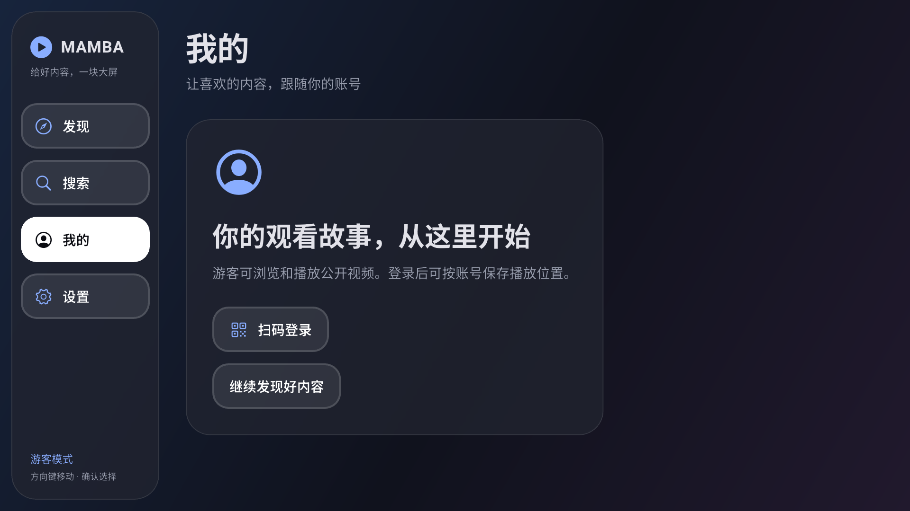

# M3：扫码登录、会话恢复与账号隔离验收

日期：2026-10-24。状态：代码已实现，本机与 API 36 x86_64 Android TV 模拟器核心流程验证通过。用户本次授权扫码、验证恢复和退出，真实账号已完成该流程并退出。自然续期、真实失效后重新扫码、物理 TV／ARM 和长期稳定性仍待补验。

后续更新：应用日志已接入 Talker，见 [日志约定](logging.md) 与 [后续验证](talker-verification.json)。本记录的测试数量与 APK 哈希保留 M3 完成时的快照，最新产物以日志更新报告为准。

架构保持 Flutter + Riverpod + Freezed + MVVM + 整洁架构；延续 M2 的深色 iOS 风格。设计与协议决策见 [ADR 0003](adr/0003-m3-authentication-and-session-scope.md)、[接口记录](api-contracts.md) 和 [开发计划](development-plan.md)。

## 实现范围

- `domain/auth` 定义挑战、状态与 AuthRepository；SessionRepository 是唯一会话来源。页面状态使用 Freezed，页面实例通过 Riverpod family 隔离。
- Web 扫码申请、等待扫描／确认、成功、过期、失败；默认两秒间隔且不重叠，网络错误有限退避，第三次失败停止。刷新、返回、后台、销毁取消本轮，前台重新申请，迟到结果不能提交登录。
- nav 身份校验成功后才保存安全凭据并发布登录；启动先恢复再校验。游客、恢复中、已登录、失效、离线与存储失败分别展示操作。
- Cookie 检查、single-flight 续期、持久化后确认旧令牌、确认中断恢复。业务请求不会因鉴权失败自动重放。
- 本机退出立即切断身份；安全存储删除、无秘密的阻止恢复标记、串行写入和迟到写回滚。服务端退出失败仍保持本机退出并显示提示。
- API 实例捕获账号身份及 generation；旧实例取消，缓存与本地进度按账号隔离。隐藏的旧播放器关闭但不弹走新登录页；回跳仅允许本应用路径，播放需再次确认。
- 账号页、二维码页、恢复／清除操作与退出确认可使用遥控器，保持高对比焦点和玻璃面板。

## 真实账号与原生结果

| 场景 | 结果与证据 |
| --- | --- |
| 游客申请与未扫码轮询 | 真实 HTTPS 二维码目标为 account.bilibili.com；未扫码状态通过，见 [guest-qr-contract.json](m3-evidence/guest-qr-contract.json) |
| 真人确认扫码 | 用户手机确认后发布已登录，回跳账号页；没有通过浏览器导入 Cookie |
| 跨进程恢复 | 登录进程 9163，强制结束后成功恢复进程 9622；安全存储存在、Session authenticated、nav 身份匹配 |
| 账号下业务与播放 | 热门 12 项、详情／分 P、独立 AVC/AAC 资源通过；公开样本 BV1U3n46GEzY 实际播放到 00:08，见 [播放截图](m3-evidence/authenticated-playing.png) |
| 真实退出 | 遥控器确认退出，服务端 code=0/status=true；Session anonymous、安全凭据不存在、无服务端退出失败提示 |
| 退出后再次冷启动 | 新进程 9948 仍为 anonymous，安全存储无凭据；见 [真实账号安全报告](m3-evidence/real-account.json) |
| 原生合成流程 | 真 Android 安全存储＋隔离键空间；返回停止轮询、扫描／成功、持久化、新仓储实例恢复、退出清除、再次恢复游客通过，见 [native-auth.json](m3-evidence/native-auth.json) |
| Flutter MCP | 发现并连接 DTD，热重载成功；账号／详情／播放器交互完成，最终运行错误为空 |

合成原生测试的“新仓储实例”不代表完整进程重启，报告明确标记；真实账号报告才记录本次完整跨进程恢复。用户名、UID、Cookie、刷新令牌、扫码 key／URL 和临时媒体地址不写入证据。活跃二维码仅保留在忽略目录 `.m0/` 供用户扫码，不作为文档截图。



## 自动验证

最终 **64 项单元／Widget 测试全部通过**，包含既有 35 项回归与 M3 新增 29 项。M3 覆盖安全持久化、迟到恢复／写入、删除失败 tombstone、离线与失效区别、10 并发刷新合并、确认中断恢复、二维码状态与取消／后台／过期／退避、允许列表回跳、原生 Cookie 头与表单、请求取消和 A→退出→B Provider 身份隔离。另覆盖隐藏播放器在账号变化时关闭，并保持登录路由。Flutter CLI 与 MCP 静态分析均无问题。

RSA-OAEP 使用 PointyCastle 4.0.0，加密合成 refresh 消息后由 Node v24.21.0/OpenSSL 独立解密；未持久化私钥或使用真实凭据，见 [crypto-interoperability.json](m3-evidence/crypto-interoperability.json)。静态分析、最终测试数量和 APK 信息见本目录 [verification.json](m3-evidence/verification.json) 与 [debug-apk.json](m3-evidence/debug-apk.json)。

验证中修正了真实二维码链接的允许域名；开发期诊断入口曾因先初始化普通 WidgetsBinding 再启用 Flutter Driver 出现启动断言，已调整顺序并重新构建。该入口仅位于 tool，不进入默认产品入口。此前一次测试遗漏二维码取消导致测试计时器残留，已显式完成页面退出，回归通过。早期 Driver 等待已离开的页面控件超时不当作业务错误；最终运行错误单列检查。

## 重现

```powershell
flutter pub get
dart run build_runner build
flutter analyze
flutter test
node tool/m3_oaep_verify.cjs
dart run tool/m3_probe.dart
flutter drive --driver=test_driver/m3_integration_test.dart --target=integration_test/m3_auth_flow_test.dart -d emulator-5554
flutter build apk --debug
flutter run -d emulator-5554
```

QR CLI 仅申请并轮询一次，完成后取消，不自动持续申请。原生合成测试使用 `m3.validation.` 前缀，不读写个人凭据。`tool/m3_app.dart` 是开发诊断入口，启用 Driver 和只返回安全元数据的只读 handler；`tool/m3_driver_probe.dart` 通过本地环境变量 M3_VM_URI 访问它，不输出凭据与原始服务响应。默认产品 APK 不包含这些入口。

最终默认 `lib/main.dart` 调试 APK 已安装并由 LEANBACK_LAUNCHER 冷启动成功，当前为游客状态。APK 大小 239288194 字节、SHA-256 及入口见 [debug-apk.json](m3-evidence/debug-apk.json)；它不是正式签名发布包。

## 后续边界

本次新登录没有被服务端要求自然续期，不能据此宣称真实刷新已通过；真正过期后的扫码重登、长时休眠、设备备份恢复、多个真实账号切换仍需受控设备补验。A/B 隔离与过期重登入口目前采用合成账号测试。未做收藏、投币、关注或历史心跳写入；个人列表在 M6，完整播放能力在 M5，物理 TV／ARM 与发布签名在 M7。
