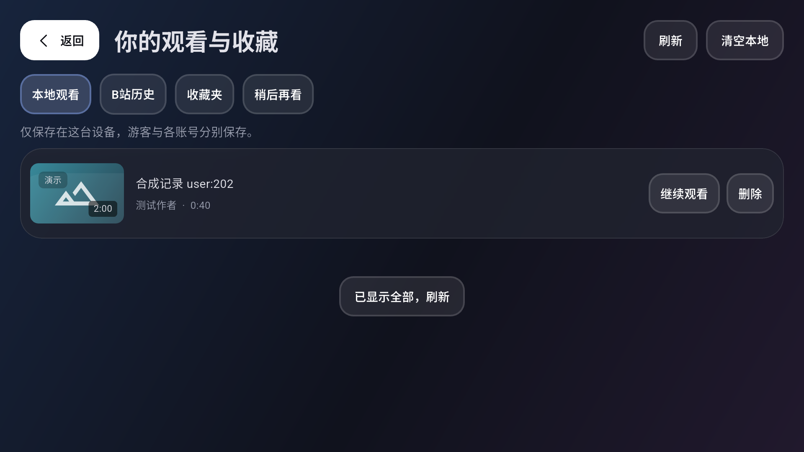

# M6 观看记录、个人列表与设置验收

日期：2026-10-25。实现采用 Flutter + Riverpod + Freezed + MVVM／整洁架构，延续深色 iOS 玻璃风格与遥控器焦点导航。

当前结论：功能已实现，本机与 API 36 x86_64 TV 模拟器自动验证通过；用户真实扫码后的个人列表**只读验收通过**。真实账号收藏／稍后再看写入和观看心跳未验收，按用户本次授权保留。不能据合成写入测试宣称真实账号写入已通过。

## 已交付

- “我的 → 观看记录与个人列表”提供本地观看、B 站历史、收藏夹与稍后再看。各自分页，长列表懒加载；空状态、显式刷新、读失败与已有内容保留分开处理。
- 本地记录按最近写入排序，同一视频仅显示最近观看的分 P；支持续播、删除、清空。所有本地命令只作用于当前 owner，确认框打开后账号变化会取消命令。
- B 站历史保持独立，进入对应分 P；有效本地续播点优先，远端位置只作无有效本地点时的回退。完成记录不会被较旧远端位置回退。
- 详情与列表的“管理”读取当前收藏夹／稍后再看状态，显式添加／移除。操作中禁止再次提交，POST 最多一次，之后读取最终状态；响应丢失且状态不确定时保留待确认意图，仅允许重新读取，不自动重放。
- 设置包含减少动态效果、记住位置、默认倍速／清晰度、分 P 连播、观看进度同步、临时缓存清理、账号管理和实际安装版本。同步默认关闭，开启有明确确认；仅持续播放期间每至少 30 秒上报，暂停／缓冲重新计时，停止后不补发队列。
- Drift v1→v2 仅新增历史元数据快照表，保留旧进度和搜索记录；旧记录无标题时显示视频标识。快照不是签名媒体地址。
- 清缓存仅清理 HTTP 内存、封面磁盘／内存缓存。保留安全凭据、偏好、搜索与各 owner 的观看记录。

实现边界见 [ADR 0007](adr/0007-personal-library-and-history.md)。私人列表不进入磁盘或通用 HTTP 缓存，刷新失败仅可保留当前会话已有页面并提示；退出和换号取消请求、隔离页面。

## 自动验证证据

| 验证 | 结果与范围 |
| --- | --- |
| 全量 Flutter 单元／Widget | 176 项通过，包含原 M0–M5 回归；运行生成覆盖率 |
| 流水线守卫 | 12 项 Python 测试通过；没有改动工作流 |
| 代码生成／格式 | 29 个生成文件重复生成稳定；179 个 Dart 文件格式检查无需改动 |
| 产品 Debug APK | 三 ABI 构建及包名／版本／TV 入口／签名／SHA256 校验通过，见 [debug-apks.json](m6-evidence/debug-apks.json) |
| Flutter MCP 分析 | No errors，静态分析无诊断 |
| 迁移与本地数据 | v1 原进度／搜索保留、v2 schema 校验、同秒分 P 去重与 24 条分页、owner 删除／清空隔离 |
| 传输／仓储 | 历史游标、收藏夹与内容、WBI 稍后再看、CSRF form、添加／移除、响应丢失后确认、不确定写入禁止重放、列表不完整时拒绝据“未找到”写入 |
| 状态／设置 | 分页去重与停止、刷新失败保留、旧会话取消、Provider build 无写入、待确认只读重查、默认偏好／画质回退、本地续播优先、心跳节流、缓存命令防重 |
| 小分辨率 UI | 800×450 本地第 21 条遥控导航／删除、长收藏夹弹层、文件夹返回、游客登录入口、账号变化时确认保护、设置长列表重新进入和反馈可见 |
| 原生独立验证包 | [native-library.json](m6-evidence/native-library.json)：真实 Android Drift／偏好／封面缓存插件，25 秒续播与 1.5 倍速、清理边界、合成 A→游客→B、一次合成个人列表命令 |
| 真实账号只读 | [real-readonly.json](m6-evidence/real-readonly.json)：远端历史及下一页、收藏夹、夹内内容、稍后再看、详情状态读取；实际 API 写请求计数差为 0 |

原生集成测试的播放引擎和远端列表使用 Fake，验证路由、设置装配和状态边界，不替代 M5 的真实音视频验证。真实账号样本没有可用的收藏夹／稍后再看下一页，相关页码契约由合成测试覆盖。真实身份、名称、列表内容、二维码、Cookie 不进入公开证据；截图使用合成内容。



完整脱敏汇总见 [verification.json](m6-evidence/verification.json)。开发期 Driver 曾等待未挂载的列表页尾而超时，未将此自动化定位问题计作业务异常；独立原生流程两次均通过。

## 重现

```powershell
dart run build_runner build
dart format --output=none --set-exit-if-changed lib test integration_test test_driver tool
flutter analyze --fatal-infos
flutter test --coverage --reporter expanded
flutter drive --driver=test_driver/m6_integration_test.dart --target=integration_test/m6_library_flow_test.dart -d emulator-5554 --dart-define=MAMBA_VALIDATION_APP=true --no-uninstall-first --keep-app-running
flutter build apk --debug --target lib/main.dart
```

原生测试强制要求 `MAMBA_VALIDATION_APP=true`，包名为 `app.mamba.mambatv.validation`，仅重置命名的 `mambatv_m6_validation` 数据库及验证偏好。不得以默认 drive 卸载主应用来运行测试。

真实账号仅在用户主动扫码后，从原生安全存储读取当前会话：

```powershell
flutter run -d emulator-5554 -t tool/m6_app.dart --dart-define=MAMBA_READ_ONLY_VALIDATION=true
# 从运行输出获取本轮 VM Service URI；不要复用旧端口。
$env:M6_VM_URI='http://127.0.0.1:<port>/<auth-code>/'
dart run tool/m6_readonly_probe.dart
```

只读标志在 API POST 入口阻止个人列表变更和心跳，不绕过扫码、账号校验或安全存储。本次保留主应用已登录状态，没有操作真实退出或开启同步。

## 尚未验收

- 真实账号添加／移除收藏与稍后再看，以及主动开启后的心跳在 B 站历史中的实际效果；需要另行授权。
- 物理电视／ARM、自然过期／风控／限流、M7 的 2 小时与发布签名验收。
- 人工音画同步沿用 M5 的未验收状态。
- 断网仍能读取本地记录并进入续播流程；实际视频在线播放需要重新获得有效网络资源，本阶段不提供离线下载播放。
- M6 的 GitHub 提交、推送及托管 CI 尚未执行；此前 CI 成功记录对应 M5／CI 基础提交，不作为本次代码的远端验证。

M7 后续更新：用户已将原 2 小时目标调整为 15 分钟，当前结果见 [M7](m7-validation.md)；本文件保留 M6 时点证据。
