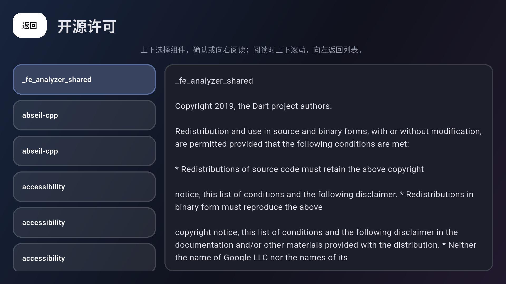

# M7 发布准备与模拟器验收

实施：2026-10-25；整理完成：2026-10-26。状态：本机／模拟器与发布准备已完成，正式发布验收未完成。用户将原计划 2 小时稳定性验收改为 **15 分钟**。本轮保留 20 次播放器进出、自动下一 P、时间轴与资源释放检查；真实 TV／正式签名与真实账号写入单列，不默认为通过。

设计见 [ADR 0008](adr/0008-release-readiness-and-validation.md)。M6 工作区变更一并保留，本轮尚未提交推送、创建标签或公开 Release。

## 实施内容

- 固定包名 app.mamba.mambatv、Android API 24、三 ABI 的构建策略与现有 1.0.0+1 版本。替换默认 Flutter 图标／临时 banner，提供 API 24 矢量回退、API 26+ adaptive 图标与 320×180 xhdpi banner。
- 设置增加遥控器可用的开源许可入口，长组件列表与完整正文分栏；按需读取 Flutter LicenseRegistry 和 13 份已收集的原生许可／来源文本。
- 生成 180 项解析依赖清单，其中 137 项位于直接运行依赖的可达图中，包含版本、来源、许可证摘要；SDK 组件引用同 SDK 的 Flutter 许可。图可达不表示成品一定链接了所有这些包。
- CI 新增锁文件／原生声明一致性检查；打包时必须携带依赖清单、Dart 与原生声明、安装说明、限制和来源，且一并纳入 SHA256SUMS。
- APK 校验精确比对 versionCode 与基础 build number＋ABI 偏移，拒绝使用旧 build number 的错误产物。
- 提供独立游客 profile 稳定性测试、一次性测试签名 Release 构建工具、专用新 AVD 的同签名升级／原生 v1→v2 合成数据迁移工具。

## 验证与证据

汇总见 [verification.json](m7-evidence/verification.json)。

| 检查 | 结果 |
| --- | --- |
| Flutter 回归／覆盖率 | 179 项单元与 Widget 测试通过 |
| 质量与流水线 | MCP 无静态诊断；186 个 Dart 文件格式无需改动；30 个生成文件重复生成稳定；12 项 Python 守卫与 actionlint 通过 |
| profile 采样 | 连续窗口 900 秒，收尾后报告计时 902 秒；累计媒体进度 899333 ms，自然 P1→P2 一次，最终样本无原生错误事件 |
| 播放器释放 | 20 次进出；总计 22 个引擎创建并全部释放，最大同时存活 1，返回后 0 |
| 资源观察 | 最后五次闭合周期 RSS 范围 344899584–351662080 字节，波动约 6.45 MiB；仅代表这次采样，不能等同于全部底层内存立即归还 |
| UI 帧采样 | 有界窗口 build／raster P95 为 1.782／6.847 ms，不代表原生视频解码帧率 |
| 产品打包 | 默认入口三 ABI Debug 与测试签名三 ABI Release，包名／版本／ABI／签名／TV 入口及校验和通过；附带六份发布文档和变更说明 |
| 签名升级 | 专用 AVD 上真实 Release 4001→4002 覆盖安装；通过实际 TV 设置修改的 reducedMotion 偏好保留 |
| 许可页 | 实际 Release 界面打开成功，13 份原生许可已在 APK 中；长列表与全文 D-pad 自动测试通过 |
| Flutter MCP | 只读独立 Debug 验证包热重启成功，许可路由可达，运行时错误集合为空 |

在第 540 秒样本记录到原生 avsync 14.300016 秒，下一分钟恢复到约 0。完整数据保留，**人工音画同步未标记通过**。15 分钟自动检查的结论只适用于已说明的时间轴、路由、资源与采样范围，不是正式发布或人工听感结论。

证据：[15 分钟原始报告](m7-evidence/native-15-minute.json)、[资源汇总](m7-evidence/stability-summary.json)、[Debug APK](m7-evidence/debug-apks.json)、[测试签名升级](m7-evidence/native-signed-upgrade.json)、[Release 许可页](m7-evidence/release-licenses.json)。



- [环境与播放源代码摘要](m7-evidence/environment.json)：API 36 x86_64 TV 模拟器，主包和独立验证包分开，未使用真实账号。
- [测试签名构建](m7-evidence/test-signing-build.json)：一次性本地证书，已删除密钥；不能视为正式密钥或正式发布验收。
- [未通过的时钟样本](m7-evidence/rejected-clock.json)：拒收了媒体进度与单调计时差 212982 ms 的样本，未放宽 30 秒阈值。
- [未通过的播放样本](m7-evidence/rejected-playback.json)：自然 P1→P2 后观察到失败状态，原测试立即拒收；当前增加安全错误分类和 20 秒内自动恢复检查（最终采样没有出现原生错误事件），仍要求整体时间轴偏差受限。

失败路径的测试清理已改为先等待播放器关闭并移除 Widget，再关闭数据库，避免验收失败后的异步保存访问已关闭 SQLite。此变更位于测试支架，不把清理问题当作产品升级丢数据。

采样保存实际 rate、native speed、媒体时间、单调 elapsed、音轨采样率、RSS、图片缓存字节、引擎存活数和安全原生错误类别；帧样本环形窗口最多 4096 项，避免验收工具自身无限占用内存。原生 avsync 数值不能代替人工听看。

## 重现

```powershell
flutter pub get --enforce-lockfile
dart run build_runner build
python tool/release/dependencies.py --check
flutter analyze --fatal-infos
flutter test --coverage --reporter expanded
python -m unittest discover -s tool/ci -p 'test_*.py' -v
flutter drive --profile --keep-app-running --no-uninstall-first --dart-define=MAMBA_VALIDATION_APP=true --dart-define=MAMBA_READ_ONLY_VALIDATION=true --dart-define=M7_SOAK_SECONDS=900 --driver=test_driver/m7_stability_test.dart --target=integration_test/m7_stability_test.dart -d emulator-5554
```

长时运行期间避免在同一受限宿主并行进行原生 AOT／Release 构建；设备序号每次核对。诊断短流程不是 15 分钟通过证据。

一次性测试签名工具在 .m0 中生成仅供验收的密钥与 APK，构建后删除密钥，不修改正式签名配置。升级脚本强制验证 AVD 名称为 Mamba_TV_M7_Signing_API36，默认拒绝其他设备及已有应用安装。该镜像禁用 root，本次通过真实 TV 设置页面修改并验证偏好，未注入旧数据库或绕过私有数据保护；SQLite v1→v2 原数据保留由本机迁移测试验证。专用测试 AVD 已清理，主模拟器恢复。工具参数与源码见 tool/release。

## 尚未验收

- 指定物理 TV／盒子及其 SoC、Android 版本、ARM 解码、实际遥控器与扬声器／人工口型同步。当前未提供目标设备。
- 正式密钥的保管、CI Secrets 配置、该正式身份的升级安装。当前未提供正式密钥，不用一次性证书代替。
- 真实账号收藏／稍后再看写入及心跳，仍沿用用户的只读授权。
- 自然凭据过期／续期、真实风控／限流与长于本轮 15 分钟的稳定性结论。

[安装与升级](release/installation.md)、[已知限制](release/known-limitations.md)、[第三方来源](release/sources.md) 随包复核。UI 品牌规格核对依据 [Android TV 官方检查清单](https://developer.android.com/training/tv/publishing/checklist)，不据此宣称已通过应用商店审核。

Debug 首次连接曾在 1 GiB 专用 AVD 变为 offline 时丢失 DevFS，未作为通过证据；改在既有 Mamba_TV_API36 的独立验证包上完成 Flutter MCP 热重启和路由检查。并行 Flutter 构建／测试造成过插件注册文件冲突，已串行重建；后续操作仍须串行执行这些会生成 Android 插件文件的命令。
