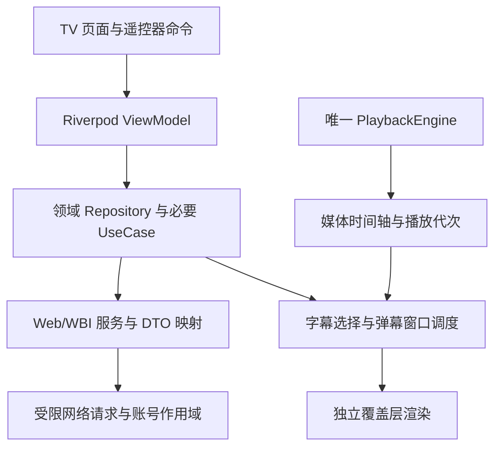

# M8／M9 详细开发计划

> 本文的历史规划已并入[总开发计划第 11 节](development-plan.md#11-m8m9详细开发计划)。下方旧章节保留链接与当时估算，当前实施以总计划及 [M9 验收](m9-validation.md)／[ADR 0011](adr/0011-m9-typed-content-and-live.md) 为准：已实现类型化基础、PGC 与直播基础观看；数据库实际 v3→v4，Android 使用 Better Player／Media3；直播推荐受风控，投屏／下载／多账号仍延期。

日期：2026-10-26。状态：M8 必交功能已实现，202 项回归及真实账号只读验证通过，持续弹幕性能未通过，尚未完成 M8 验收；M8-5 点赞／投币独立延期，M9 核心实施见 [验收](m9-validation.md)，可选模块继续规划。实际结果见 [M8 验收](m8-validation.md) 与 [ADR 0010](adr/0010-m8-media-overlays-and-discovery.md)。本文承接已发布的 [v1.0.0](https://github.com/Brokenheart100/BlibiliTV/releases/tag/v1.0.0)，细化 [总开发计划](development-plan.md) 中的 M8／M9；不改变 M0–M7 的历史验收记录。

## 1. 当前基线与交付目标

| 项目 | 当前事实 | 对后续工作的约束 |
| --- | --- | --- |
| 发布 | v1.0.0，源码提交 `7eef332cc19caad9759b760a05bcd1bd4011be38` | 后续从该基线增量演进，不回退到原规划的 v0.1.0／v0.2.0 编号 |
| 托管验证 | [CI](https://github.com/Brokenheart100/BlibiliTV/actions/runs/40210596029) 与 [发布流水线](https://github.com/Brokenheart100/BlibiliTV/actions/runs/40210598808) 成功；179 项 Flutter 测试、13 项流水线守卫 | 新功能增加有意义的回归；测试数量不是验收目标 |
| 发布平台 | Android API 24 起；Release 为 armeabi-v7a／arm64-v8a，x86_64 留在 CI Debug artifacts | 不因新增功能放弃 ARM32；平台最低版本变化需单独决策 |
| 技术栈 | Flutter、Riverpod Notifier／AsyncNotifier、Freezed、Dio、Drift、Android Better Player／Media3 与 media_kit 回退 | 沿用 MVVM／整洁架构，不切换状态管理或重复引入播放器 |
| 播放 | 当前是普通 UGC，`PlaybackRepository.resolve(videoId, partId)`；唯一引擎由 `PlaybackCoordinator` 管理 | M8 复用播放会话；M9 扩展类型化目标，不能把 roomId／episodeId 塞进 BVID |
| 验证设备 | API 36 x86_64 TV 模拟器；M7 15 分钟／20 次进出／自然下一 P | 不把模拟器结果写成物理 ARM 电视通过；不恢复成 2 小时循环 |
| 未完成验证 | 物理 TV、人工音画同步、真实账号写入、自然凭据续期；M7 存在单点 avsync 约 14.3 秒后恢复 | 纳入前置诊断与发布说明，不能用新增字幕／弹幕掩盖播放器时钟问题 |
| 正式签名 | 长期密钥和四项 Secrets 已配置，首次正式签名发布成功 | 后续复用同一密钥、递增 build number；独立介质备份待维护者确认 |

**M8 目标：增强普通视频观看与发现。** 必交字幕、只读基础弹幕、UP 视频、关注视频流、基础搜索筛选及 TV 设置；点赞／投币作为可拆分的独立增量。

**M9 目标：逐项接入新的内容类型与设备能力。** 核心包先交类型化播放、番剧／影视和直播基础观看；投屏、下载、多账号分别通过专项验证后交付，不捆成一次大版本。

本规划没有授予真实账号写入权限。用户随后授权开始 M8，本轮实施读取接口、安装依赖、本机与模拟器验证及本地候选构建；此前真实账号的只读边界继续有效。真实点赞、投币、收藏、心跳仍须对应授权，公共发布另行执行。

## 2. 设计原则与架构约束

1. **延续 iOS 风格，操作按 TV 设计。** 深色背景、大字号、圆角和局部毛玻璃；方向键、确认、返回覆盖全部流程。毛玻璃限制在菜单／面板，不在整块视频上叠加高成本模糊。减少动态效果时保留焦点轮廓和选中状态。
2. **View 负责呈现，ViewModel 负责交互，Domain 定义规则，Data 实现协议。** 只有 app 装配和 UI 使用 Riverpod；Domain／Data 不接收 `Ref`。DTO／protobuf 生成类型不能透传页面。
3. **一个原生播放会话。** 字幕和弹幕读取同一媒体时间轴；换 P、换源、seek、暂停、缓冲、后台与释放均显式通知覆盖层。页面重建不重新打开引擎。
4. **高频渲染局部化。** 页面状态与逐帧覆盖层分离；不把逐条弹幕、绘制位置或每帧 tick 塞进根 `PlayerState`。不以独立计时器累计播放时间。
5. **所有异步工作带作用域。** 使用 ownerKey、会话代次、内容目标、播放代次；请求取消与结果代次检查同时存在。Provider 自动释放不替代路由隐藏／后台处理，参见 [Riverpod 生命周期](https://riverpod.dev/docs/concepts2/auto_dispose)。
6. **增强能力可独立失败。** 字幕／弹幕不可用不阻止视频播放；关注流失败不自动混入其他来源；新内容解析失败不退化为错误的 UGC 播放。
7. **优先复用库，保留可替换端口。** 应用只实现业务调度、作用域、协议映射和 TV 交互；播放器、protobuf、弹幕绘制、后台任务与设备协议优先评估现有实现。
8. **以证据决定支持范围。** 上游代码、合成契约、本机测试、模拟器、物理 TV 和人工验收分别记录。既有的 avsync 诊断不由字幕偏移功能“修正”为通过。

### 2.1 M8 的模块划分

以下为 M8 实际采用的契约／目录；可选互动与 M9 仍是规划：

| 模块 | 拟新增类型／职责 | 放置位置 |
| --- | --- | --- |
| 时间轴 | `PlaybackTimeline` 复用 `EngineSnapshot`；媒体锚点与 discontinuity／播放代次 | `lib/domain/playback/`；适配装配复用 `lib/app/providers/playback_providers.dart` |
| 字幕 | `SubtitleRepository`、`SubtitleTrack`、`SubtitleCue`、轨道解析与选择 | `lib/domain/overlays/`、`lib/data/repositories/` |
| 弹幕 | `DanmakuRepository`、`DanmakuItem`、分段窗口与过滤；画布适配 | `lib/domain/overlays/`、`lib/data/services/danmaku/`；具体画布适配放 UI |
| 播放覆盖层 | `SubtitleViewModel`、`DanmakuViewModel`、`SubtitleChoice`、`PlaybackOverlays` | `lib/ui/features/player/` 下各自的 ViewModel／View，避免继续扩张主 PlayerViewModel |
| UP／关注 | `CreatorRepository`、`FollowingFeedRepository`、列表分页状态 | `lib/domain/discovery/`、`lib/ui/features/creator/`；关注复用首页 CatalogPage |
| 互动 | `VideoInteractionRepository`、状态读取与一次性命令 | `lib/domain/interactions/`；详情／播放器共享同一个领域入口 |
| 装配 | 页面参数、账号代次和 Repository 依赖图 | `lib/app/providers/`，不在 View 内 new Service |

`SubtitleCue`／`DanmakuItem` 等不可变领域值、菜单状态使用 Freezed；传输 JSON 使用 json_serializable；protobuf 使用其自身生成器。签名 URL 保持短期数据层资源，不能进入 Freezed 默认 `toString`、路由、Drift 或日志。

### 2.2 数据流

字幕／弹幕的轨道或分段数据可以异步加载，但是否展示由当前播放代次和媒体时间决定。关闭功能立即清空画面，取消网络、解析与绘制任务；不是仅设透明度为 0。

## 3. M8 范围与开发顺序

### 3.1 版本边界

| 级别 | 内容 |
| --- | --- |
| 必交 | UGC 字幕轨道、关闭／切换／样式／偏移；基础只读弹幕；UP 视频页；关注视频流；基础搜索筛选；对应偏好、焦点、故障与性能验证 |
| 可拆分增量 | 点赞／取消点赞、明确数量的投币；先完成合成命令测试，真实验收单独授权 |
| 本阶段不交 | 弹幕发送、弹幕点赞／举报、代码／BAS／高级弹幕、自动翻译、语音转字幕、评论编辑、关注关系修改、私信 |

建议先发行 M8 必交部分为 `v1.1.0`；互动在验证完成后以独立补充版本交付。实际候选构建时递增版本，公共标签与 Release 仍按正式流程执行。

### 3.2 工作包、估算与依赖

估算按单人全职有效人日，不把等待用户、硬件、风控解除或商店审核算作确定工期。每个工作包结束后重估剩余工作。

| 编号 | 工作包 | 前置 | 人日 | 完成交付 |
| --- | --- | --- | --- | --- |
| M8-0 | 风险诊断、接口／依赖 spike | v1.0.0 | 2–3 | avsync 诊断记录、候选接口矩阵、库评测和可行性结论 |
| M8-1 | 媒体时间轴与覆盖层骨架 | M8-0 | 1–2 | 暂停／seek／换源／后台契约，单时钟 Fake 回归 |
| M8-2 | 字幕完整纵向流程 | M8-1 | 3–4 | 多轨字幕、样式、偏移、错误降级、TV 菜单 |
| M8-3 | 分段弹幕、过滤与性能 | M8-1；字幕避让基线来自 M8-2 | 4–6 | 只读基础弹幕、分段取消／淘汰、渲染适配与密度降级 |
| M8-4 | UP 页、关注视频流与基础搜索筛选 | M8-0；复用既有分页／焦点 | 3–5 | 可遥控列表、已验证的筛选／排序、详情／播放返回恢复 |
| M8-5 | 点赞与投币独立增量 | M8-0；真实写入另行授权 | 2–3 | 防重复命令、结果确认、取消与错误状态 |
| M8-6 | 故障、迁移、性能与候选发布 | 必交工作包 | 3–4 | 回归、15 分钟报告、已知限制和 ARM 候选包 |

全量约 **18–27 人日**；剥离互动约 **16–24 人日**。全量加 25% 接口／兼容缓冲约 **23–34 人日，5–7 个工作周**。原总计划的“5–10 人日起”不再作为完整 M8 的估算。

### 3.3 M8-0：先解决未知项

- 使用固定 UGC 样本覆盖：无字幕、单轨、多轨／AI 标识、多个分 P、不同弹幕密度。只保存公开 ID、字段结构、大小和失败类别；不记录个人文本、Cookie、二维码或签名 URL。
- 对 M7 的 avsync 单点异常做一次有时间戳的复核：同时记录 position、rate、buffering、播放代次和原生 avsync；明确指标来源／单位，区分真实不同步与诊断字段异常。若存在可复现的持续漂移，先修复播放问题再推进覆盖层；仍未复现则保留未验收项，不伪称已解决。
- 核对 Web Cookie + WBI 能否读取字幕元数据、字幕正文和弹幕分段；不直接照搬 App gRPC 的凭据、设备指纹或访问令牌。
- 在真实 `mediacodec_embed` 画面上验证 Flutter 覆盖层可见、裁切正确、菜单可操作，不能只在静态图片上演示。
- 评估弹幕库的暂停、清空、速度更新、生命周期和显式媒体时间调度。若库只按墙钟跑动画，必须验证 seek／倍速重建方案；不能满足就更换候选，不能伪造时间同步。
- 输出 `docs/m8-evidence/interface-spike.json`、`dependency-spike.md` 与诊断结果；先不批量安装所有候选库。

### 3.4 M8-1／M8-2：字幕

**实现步骤**：

1. 为当前播放会话暴露只读时间轴，包含媒体位置、倍速、playing／buffering、内容／会话代次及 seek／换 P 事件；Domain 不依赖 Flutter ticker。
2. Repository 将元数据映射为轨道 ID、语言、名称、可用状态及 AI 标识（仅在来源提供时展示）；正文资源定位与必要请求头留在数据层。
3. 首批只实现已实测的 B 站 JSON 字幕。使用整数时间单位、排序与范围校验，兼容空白／重叠 cue；不把正文当 HTML 执行。SRT／WebVTT 导入不进入必交范围。
4. 优先采用 Flutter 字幕覆盖层，以复用 TV 样式和弹幕避让。media_kit 已有 `setSubtitleTrack`，但当前 Domain 端口未暴露；若 spike 显示 Flutter 合成不可行，需记录 ADR 后评估原生字幕适配，不同时渲染两套字幕。
5. 按系统／用户语言匹配已提供轨道，用户可以关闭或切换。默认偏好为“有可用字幕时按语言自动选择”，无字幕时保持视频播放。
6. 大小提供小／标准／大档位，支持安全区、描边或半透明底板；默认不超过两行，长文本截分规则写入测试。偏移提供 -5 至 +5 秒、每步 0.1 秒的初始方案，并明确“正值延后显示”。
7. 暂停／缓冲冻结，seek 立即重定位 cue；换 P 清空旧轨，换画质保留同内容的用户选择；旧请求迟到不能覆盖新轨。恢复位置在用户操作完成后由真实媒体事件校准。
8. 轨道／正文失败只提示一次局部错误，提供菜单内重试；不重建原生引擎，不清空视频进度。

**遥控器流程**：确认显示控制条 → 下移到“字幕” → 右侧圆角面板 → 轨道／样式／偏移；返回只关闭当前面板并回到触发项。字幕文本不参加焦点遍历。

**验收**：合成边界定位误差目标不超过 100 ms；原生可见字幕在 seek／倍速后相对采样媒体时钟目标不超过 250 ms。分别记录测量方法，以上不代表人工口型同步通过。覆盖 0.5／1／2 倍速、前后 seek、切轨、空轨、缓冲、自然下一 P、后台恢复和退出释放。

### 3.5 M8-3：只读弹幕

**实现步骤**：

1. 明确 Web 读取协议、protobuf schema 来源和版本；protobuf 仅是序列化格式，不代表需要引入 gRPC。未知字段兼容，截断／超大消息返回安全失败。
2. 分段长度优先来自已验证元数据；不得仅凭旧文档写死“每段固定若干分钟”。初始保留“前一／当前／后一”最多三段，seek 后取消旧窗口请求并直接定位目标段。
3. 初始网络并发上限 2；压缩响应单段目标上限 2 MiB、解压上限 8 MiB、解析后单段最多 20000 条，全局覆盖层缓存预算 32 MiB。数值是待 spike 测量的应用预算，超限分批处理／丢弃并给出安全状态，不能无限分配。
4. DTO 转领域模型后按 ID 去重、按媒体时间排序；同一时间使用稳定次序。前向 seek 不补播已跳过内容，回退 seek 从目标时间重新调度，不能重放整个旧窗口。
5. 首批支持普通滚动、顶部、底部文本；过滤不支持模式。提供开关、字号、透明度、密度、显示区域和本机关键词屏蔽；不读取／修改云屏蔽列表。
6. 默认关闭，首次由用户开启并保存设备偏好。标准模式屏上活动条数初始上限 40，低负载模式 20；弹幕过密时丢弃超额条目，不积压到几分钟后显示。
7. 字幕、控制条和菜单具有保留区域；重新布局或字幕开关后重算弹幕区域。弹幕不抢焦点，菜单操作不触发暂停／seek 的重复按键。
8. 只把新增条目送入渲染适配器，50 ms 采样查询相邻媒体事件间的有界插值；画布 ticker 仅负责自身动画；媒体快照长时间缺失或缓冲时停止外推，下一快照重新校准。
9. 关闭、后台、切内容或退出时取消窗口、丢弃过期解析结果并清空画布；取消不了的 isolate 计算仍需通过代次检查禁止回写。

**性能策略**：优先 canvas 库，不为每条弹幕构建 StatefulWidget；文字测量和缓存有上限，解析大消息才转 isolate。正常／低负载两档采用固定可复现压力样本对照，必要时降低密度／字号阴影，最后关闭弹幕并显示一次提示。恢复全量由用户明确操作，避免反复自动升降。

### 3.6 M8-4：UP 视频与关注内容

- 从现有详情 UP 信息进入 `/creator/:mid`（拟定），提供名称／头像、公开视频列表和已验证的排序选项；不把服务端不支持的筛选画成可点选功能。
- 首页“发现”内增加“关注”分页入口，保持现有四个主导航；未登录显示扫码入口并保留回跳，不能静默展示游客推荐冒充关注视频。
- 关注流首批仅处理可播放 UGC；图文、直播和番剧等记录按明确规则过滤并统计过滤数量，M9 后再扩展内容类型。
- 搜索增加已实测的排序、时长／分区筛选子集，使用侧面板和明确“应用／重置”操作；筛选条件纳入请求键与分页游标。改变条件取消旧查询，保留中文输入组合态，不假定所有服务端筛选组合都有效。
- 游标、来源、账号代次分别管理；相同游标、连续无新增内容、空页终止，刷新失败保留旧数据并提示，不无限翻页。
- UP 视频页保留 mid／排序／滚动位置／卡片稳定 ID，详情与播放返回精确恢复；关注页面隐藏时停止预取。
- 私有关注数据不加入现有通用 HTTP 缓存白名单。UP 公共数据需要缓存时单独评估 TTL、WBI 参数规范化、业务错误与刷新语义。
- 实测首屏、下一页、空列表、删除稿件、登录失效与限流；10 页分页／去重可用合成固定集验逻辑，真实请求页数遵循服务可用性，不盲目压测。

### 3.7 M8-5：点赞与投币

- 点赞读取当前状态后发送一次明确的目标状态，禁止连按产生多个命令；完成后重新读取确认。超时保留“结果待确认”，用户选择重新查询，不自动重发。
- 投币菜单显示数量、是否同时点赞（只有接口已验证才提供）和确认按钮；余额／权限不足显示原因。投币是独立提交，不与播放、开页或焦点移动绑定。
- 操作过程中退出或切账号取消 UI 等待，禁止把旧账号命令重放到新账号。对已发出的远端操作不能以本地取消宣称撤销成功。
- 沿用 M6 一次性写入和状态确认模式；不可逆或状态查询不充分的响应保留待确认，不以乐观加减余额作最终结果。
- 真实验收需要用户明确允许某条测试视频、操作和投币数量；未授权时完成 Fake／契约测试并单列未验收，可先发布 M8 必交部分。

## 4. M9：新内容类型与独立能力

### 4.1 模块化范围、顺序与工期

| 编号 | 内容 | 前置 | 人日 | 发布策略 |
| --- | --- | --- | --- | --- |
| M9-0 | 类型化播放目标、能力模型、存储迁移 | M8 媒体时间轴与稳定回归 | 3–5 | 基础重构可内部验证，不单独暴露未完成入口 |
| M9-1 | 番剧／影视基础浏览与播放 | M9-0；PGC 读取／权限 spike | 7–10 | 建议 v1.2.0，独立候选发布 |
| M9-2 | 直播列表、房间与基础播放 | M9-0；直播传输 spike | 8–12 | 建议 v1.3.0；与 PGC 运行互不依赖 |
| M9-3 | TV 投屏接收专项 | M9-0；明确协议／发送端／接收能力 | 6–10 | 可选，验证成功后独立版本 |
| M9-4 | 普通视频下载与离线播放 | M9-0；存储／本地分离音视频／断点下载 spike | 8–12 | 可选，先前台任务，后台作为后续增量 |
| M9-5 | 多账号保存与安全切换 | M8／M9 作用域规则；真实多账号条件 | 5–8 | 可选，最后引入，扩展所有现有页面回归 |
| M9-6 | 核心包交叉回归、设备和发布材料 | M9-0／1／2 | 3–5 | 每个可选模块另跑其专项与受影响回归 |

M9 核心约 **21–32 人日**，加 25% 缓冲约 **27–40 人日，6–8 周**。表内全部可选模块再增加 **19–30 人日**；表内全量约 **40–62 人日**，加缓冲约 **50–78 人日，10–16 周**。只读直播聊天室另估 2–4 人日；DRM、云端代理／转码服务、商业 Cast 接入、完整手机伴侣应用不在估算内。评论浏览、语音／手机辅助输入继续保留为后续 backlog。

建议顺序为 **M9-0 → M9-1 → M9-2 → 核心回归／发布 → M9-3 → M9-4 → M9-5**；PGC 某项服务权限受阻时，可先做独立的直播 spike，不用伪造 PGC 成功。尚未具备条件的可选模块记录延期原因，不阻断已完成内容类型的发布。

### 4.2 M9-0：先扩展领域模型

| 拟新增契约 | 设计 |
| --- | --- |
| `PlaybackTarget` | Freezed 联合类型：UGC（bvid／cid）、PGC（seasonId／episodeId／已解析 cid）、Live（roomId）、后续 Local（assetId）／Cast（sessionId） |
| `ResolvedPlayback` | 区分独立音视频、单流／自适应资源、本地资源；短期签名和请求头不持久化、不输出日志 |
| `PlaybackCapabilities` | 显式声明 seek、rate、duration、分集、音轨、字幕、历史同步能力；UI 由当前能力生成菜单 |
| 内容专用解析器 | `UgcPlaybackResolver`／`PgcPlaybackResolver`／`LivePlaybackResolver`，通过装配选择；Domain 不 import 具体 HTTP 或 media_kit |
| 历史与续播键 | `(ownerKey, contentKind, contentId, partId)`；直播只保存房间访问记录，不保存虚假 duration 或对直播 seek 续播 |

实施时保留现有 UGC 入口兼容，逐步让 `StartPlayback` 接收类型化目标；仍由唯一 `PlaybackCoordinator` 发放引擎租约。不是为每种内容启动一个播放器实例，也不把全部新逻辑塞进当前 `BilibiliApi`。

Drift 按新增持久数据需要从当前 v2 升级到 v3：旧 UGC 记录回填 contentKind 与原 ID，保留观看进度、搜索、视频元数据和 ownerKey；PGC／直播使用独立键。迁移覆盖 v1→最新与 v2→最新，使用实际 SQLite 测试。后续可选模块确有 schema 变化再递增，不预建无需求的下载／账号空表。

### 4.3 M9-1：番剧／影视

**范围**：季／剧集详情、分区与搜索中已验证的 PGC 入口、正片／附加分集、选集播放、同季续播与下一集；首批不做追番、付费购买或试看绕过。

**实现步骤**：

1. 先验证季详情、剧集 ID／cid、播放解析、权限与错误语义；至少准备免费可播、账号可播、无权限、地区／下架或等价合成错误四类样本。
2. 建立 `Season`／`Episode`／`EpisodeAvailability`，保留正片、预告、花絮的分组与原始顺序；“下一集”只在当前明确播放序列内推进。
3. UI 使用横向剧集卡与右侧信息面板，长选集懒加载、焦点记忆；进入某集先显示权限状态，播放按钮只反映当前真实能力。
4. PGC 解析器可复用已验证的音视频传输适配，不能复用 UGC ID 猜测或把 UGC 心跳直接发给 PGC。PGC 远端历史／心跳另做契约和授权验证；否则仅保存本地续播。
5. 继承 M8 字幕／只读弹幕，但以实际 cid 和内容权限重新加载；请求失败不阻断主视频，切集丢弃上一集覆盖层。
6. 试看结束按服务返回边界停止并显示说明；没有 DRM／编码支持时明确不可播放，不切第三方代理或假冒权限。

**完成条件**：免费真实剧集可用遥控器完成详情→选集→播放→下一集→退出→续播；受限样本不给出错误播放入口；20 次混合 UGC／PGC 切换最多一个引擎存活，进度与字幕不串集。

### 4.4 M9-2：直播

**第一批**：直播发现／搜索、房间信息、开播／未开播／断流状态、可用清晰度、源切换、进入与退出。只做被实测支持的传输／编码组合，不承诺所有 HLS／HTTP-FLV 或低延迟协议。

**实现步骤**：

1. 区分短房间号与真实 roomId；验证房间状态、播放资源、传输格式、CDN 请求头、清晰度和有效期，生成独立能力表。
2. `LivePlaybackResolver` 输出直播会话；控制条默认隐藏进度拖动、倍速、UGC 分 P 和续播。没有 seek 能力时不可把 duration=0 的普通播放器进度条暴露出来。
3. 直播暂停／后台释放资源；再次播放重新解析并回到直播边缘，不保证回到暂停位置。断流后受限重连，初始预算最多 3 次、退避 1／3／10 秒；房间已下播或无权限时立即停止，手动重试开启新一轮预算。
4. 清晰度切换保留房间和用户播放意图，但不承诺保留直播时间点；进入预期“重连中”状态，旧流事件不能覆盖新会话。
5. 先交不带聊天室的直播观看。只读直播弹幕作为第二批：独立 WebSocket Session、鉴权／心跳、压缩／拆包、去重、限速与取消；复用文本画布，不复用点播时间索引。
6. 礼物、付费消息、签到、发送弹幕、直播间互动不纳入本计划；长连接本身所需的协议消息与用户账号写入分别审查和记录。

**完成条件**：真实公开直播持续播放 15 分钟；断网／恢复、下播／受限、清晰度切换和 20 次进出后无残留流／声音；启用聊天室的独立子版本退出后 socket 和心跳归零。人工听感与物理 TV 另列。

### 4.5 M9-3：投屏接收专项

此处按 TV 应用的**接收端**规划；手机发送给本 TV 优先，TV 向其他设备投送另行估算，不默认两端同时实现。

- 首先明确是 DLNA／UPnP DMR、Google Cast Receiver，还是受控的本地配对协议；三者不能作为同一个插件能力混用。Google Cast TV Receiver 有自己的接入体系，参见 [官方 Receiver 概览](https://developers.google.com/cast/docs/android_tv_receiver)。
- 默认先评估 DLNA 接收器库／Android SDK，验证指定发送端的发现、播放、暂停、停止和状态查询；本计划不承诺“B 站手机官方投屏按钮必然兼容”。
- 最小媒体范围为已验证的单流、含音轨、可 seek 的资源；当前 B 站 DASH 的独立音视频不能只发送 videoUrl 就宣称完成投屏。需要额外接收器、合流或代理时，重新计算服务和维护成本。
- 外来 URL／SOAP／XML／媒体标题均视作不可信输入：限制大小、协议、重定向、会话来源及目标访问策略，不转发本机 Cookie／凭据。明文局域网传输若必要，专项评估网络策略，不为所有 B 站请求全局放开明文。
- 用户显式开启接收模式并可随时关闭；投屏占用现有唯一播放租约，不与本机视频混音。远端断开不能清除本机账号或记录，外部播放默认不写账号心跳。
- 验收至少两种已标明的发送端、同网发现、重复连接、停止、失联与本地播放接管。设备与协议不具备时标记 PoC 未通过，不把入口留成永久空壳。

### 4.6 M9-4：下载与离线

**MVP** 仅下载当前账号可获取且具备可下载条件的普通 UGC；不做 DRM／付费权限绕过、直播录制、字幕翻译或向共享目录自动导出。

1. 先证明 Android 私有目录中的独立视频／音频可由现有引擎正确配对播放、seek 和恢复；未通过前不实现完整下载管理界面。
2. 任务由稳定内容 ID、ownerKey、品质、资源指纹和完成状态描述；签名链接仅短期解析，不作为持久任务的唯一恢复依据。重启／链接过期重新解析并检查资源一致性。
3. 前台下载为第一批，初始同时一个视频任务，音／视频合计最多两个传输；状态为 queued／resolving／downloading／paused／failed／completed／removing，重复命令幂等。
4. 下载临时文件与完成 manifest 原子提交；任一轨缺失不标记完成。校验内容长度／ETag 或可用摘要；服务器 Range 行为或资源版本变化时不能直接续接旧字节。
5. 可设置存储上限并预检可用空间；低空间、写入失败与应用强杀可恢复。只删除明确属于任务的文件，显示删除确认，普通“清临时缓存”不移除已完成离线视频。
6. 离线库按账号隔离；退出／移除账号明确提供保留或删除本机文件的选项。受限内容能否离线播放取决于实际资源与权限模型，不能以本机存在文件推定长期有效。
7. 后台／设备重启续传是第二批，另选 Android 调度方案。Media3 有专门 [下载组件](https://developer.android.com/media/media3/exoplayer/downloading-media)，但 Better Player 的现有 Flutter 封装尚未提供本项目的离线端口，不能把该文档当成现成 Flutter API；后台工作需按 [Android 调度约束](https://developer.android.com/develop/background-work/background-tasks/persistent) 验证通知、生命周期与目标系统行为。

**完成条件**：一条真实分离音视频完成下载，断网后画面与音轨可播放；暂停／重启／链接过期／Range 不支持／磁盘不足／删除／账号切换均有结果；未授权跨账号文件不显示。后台能力只有在应用退出／重启设备后实测通过才列为支持。

### 4.7 M9-5：多账号

- 只增加“保存多个账号、同一时间一个活动账号”，不引入并行后台账号同步。
- 凭据仍在安全存储，Drift 只保存账号展示元数据与不含秘密的内部 key；不把 Cookie 或刷新令牌放入 JSON 偏好。
- 切换作为串行事务：冻结命令→保存／停止播放→取消请求与任务→关闭旧缓存／订阅→载入新凭据→校验或展示离线／失效→激活新 scope→恢复目标页。旧请求迟到不能写入当前 UI。
- 相同身份重复扫码更新既有条目，不创建重复账号。删除账号与退出活动账号分别定义，明确本地历史／离线文件如何保留或删除。
- 设备级外观／字幕样式与账号级历史、搜索、列表分开；当前 AppSettings 是设备级，不默认迁移为每账号一份。新增账号级偏好需单独 schema 与迁移说明。
- 扩展真实自然续期、失效账号、A→B→游客→A、后台切换和旧命令待确认场景。需要两个真实账号时由用户提供操作条件，合成账号通过不等于真实多账号通过。

## 5. 接口、依赖与缓存决策

### 5.1 候选接口矩阵

本表只记录已查看的固定上游线索，**不是本项目已通过的接口契约**。新的主机、参数、分页、字段、错误码与权限，须在实施时写入 [接口契约](api-contracts.md)，同时标注合成／真实验证级别。

本次查看 PiliPlus 提交 `affac5334fc41744894618d9fb53b7101db9532a`；它独立于 M0 的参考提交，不悄悄替换历史来源。仅用于定位设计与协议线索，未复制其实现或生成文件。

| 能力 | 固定源码线索 | 必须验证的未知项 |
| --- | --- | --- |
| 字幕 | [video.dart](https://github.com/bggRGjQaUbCoE/PiliPlus/blob/affac5334fc41744894618d9fb53b7101db9532a/lib/http/video.dart) 的 playInfo／字幕读取；[api.dart](https://github.com/bggRGjQaUbCoE/PiliPlus/blob/affac5334fc41744894618d9fb53b7101db9532a/lib/http/api.dart) 的 Web/WBI 路径 | 当前 Cookie 兼容、轨道字段、JSON 正文、过期／AI／权限语义、CDN 头 |
| 弹幕 | api.dart 中旧 Web 分段地址为注释；[danmaku.dart](https://github.com/bggRGjQaUbCoE/PiliPlus/blob/affac5334fc41744894618d9fb53b7101db9532a/lib/http/danmaku.dart) 包含发送／互动，不能当作只读分段实现 | 实际 Web 读取方式、schema 来源、分段元数据、压缩、请求参数、游客／账号权限 |
| UP／关注 | api.dart 的成员与关注流常量；[dynamics.dart](https://github.com/bggRGjQaUbCoE/PiliPlus/blob/affac5334fc41744894618d9fb53b7101db9532a/lib/http/dynamics.dart)、[follow.dart](https://github.com/bggRGjQaUbCoE/PiliPlus/blob/affac5334fc41744894618d9fb53b7101db9532a/lib/http/follow.dart) | 公开视频列表入口、排序、关注视频游标、混合卡片、鉴权、限流 |
| 点赞／投币 | video.dart 的独立命令与状态接口线索 | CSRF、目标状态、数量、读确认、响应丢失语义、余额／权限 |
| PGC | [pgc.dart](https://github.com/bggRGjQaUbCoE/PiliPlus/blob/affac5334fc41744894618d9fb53b7101db9532a/lib/http/pgc.dart)、api.dart | season／episode／cid 映射、内容解析与权限、试看、历史类型 |
| 直播 | [live.dart](https://github.com/bggRGjQaUbCoE/PiliPlus/blob/affac5334fc41744894618d9fb53b7101db9532a/lib/http/live.dart) | 主机、roomId、状态、传输／编码／CDN、重连与可选长连接 |
| 下载／投屏 | 不以其他客户端“有按钮”作为能力证据 | 成品媒体格式、鉴权／有效期、Range、接收协议与实际设备 |

每项 spike 固定“来源与日期→请求契约→脱敏／合成 fixture→真实只读样本→失败语义→可行／受阻结论”。受阻时只提供明确不可用状态，不依赖无法复现的代理或隐藏签名常量。

### 5.2 依赖选择

| 能力 | 初始方案 | 定版门槛 |
| --- | --- | --- |
| 播放 | Android Better Player 1.29.0／Media3 1.11.0；media_kit 保留 Windows／构建回退，版本以 lock 为准 | 现有 UGC 不退化；新增传输、原生字幕或本地双轨需 spike |
| 字幕 | 首批复用 Dart JSON／集合及 Flutter 文本渲染，不新建通用字幕 SDK | 已实测 JSON 足以满足需求；额外格式出现再选成熟解析库 |
| protobuf | 候选 [protobuf 6.1.0](https://pub.dev/packages/protobuf/versions/6.1.0) 与匹配 protoc_plugin／protoc | 协议确实需要、来源／许可明确、Dart 兼容、生成可重复；不手写二进制解码器 |
| 弹幕画布 | 优先评测 [canvas_danmaku](https://pub.dev/packages/canvas_danmaku)，本次查阅版本 0.3.3，候选而非定版 | 真实视频合成、暂停／清空／seek／倍速、资源释放、性能预算及维护情况通过；UI 适配端口可替换 |
| 直播 socket | 只读聊天室启用时再选维护中的 WebSocket 实现；点播弹幕不因此引入 socket | 分帧／压缩／鉴权／重连均有上限，关闭后无后台循环 |
| 投屏／后台下载 | M9 各自 spike 后确定插件或薄 Android 适配器 | 必须验证当前 Flutter／Android／ARM32，不能先把不相关插件加入生产依赖 |

新增依赖必须更新 lock、依赖清单、应用许可页和发布 notices。protobuf 的 `protoc`／插件版本及 schema 输入记录到工具链或独立生成清单；与 build_runner 步骤分开，CI 验证所有新增生成产物没有 diff。Flutter 性能方案参考 [官方性能建议](https://docs.flutter.dev/perf/best-practices)，预算本身是本项目目标，并非库的承诺。

### 5.3 缓存、持久化与隐私

- 既有 dio_cache_interceptor 只允许已验证目录元数据；不为新功能直接扩大成“缓存全部 GET”。字幕／弹幕用自己的有界内存窗口，关注、权限状态和签名资源绕过通用缓存。
- subtitle／danmaku 缓存键包含内容、轨道／段、ownerKey、会话／播放代次；关闭或账号切换后失效，失败响应不缓存为成功。
- M8 样式、字幕语言、偏移、弹幕开关／密度／本机关键词是可恢复偏好；读取旧配置缺字段使用默认值，损坏项局部恢复。大文本列表限制条数和单项长度，不存正文／整段弹幕。
- M8 若无结构化持久数据需求不升级 Drift。M9 因类型化历史升级时保留旧 UGC；下载任务和多账号按实际工作包单独演进 schema。
- Talker 仍按白名单，只记录类型、代次、计数、耗时、大小及安全错误类别；不记录字幕正文、弹幕文本、账号关注列表、URL query 或私钥路径。Release 默认日志行为沿用当前配置。

## 6. 测试、性能预算与验收矩阵

### 6.1 分层验证

| 层级 | M8 重点 | M9 重点 |
| --- | --- | --- |
| 纯 Dart／领域 | cue 边界、重叠、分段窗口、去重、seek／倍速／暂停、命令待确认 | 类型化路由、PGC 顺序／权限、直播能力／退避、下载状态、账号切换事务 |
| Data 契约 | 空／缺字段、坏 JSON／protobuf、压缩／超限、取消、业务错误、私有缓存隔离 | PGC／直播解析、URL 过期、Range／ETag、旧 schema、受限内容与凭据 scope |
| Riverpod | 页面参数与账号代次、迟到回调、释放／隐藏／后台、重建不重播 | UGC／PGC／Live 切换、旧命令不重放、离线任务与账号交错 |
| Widget | 720p／1080p／4K 布局、字幕安全区、菜单焦点、返回层级、长列表 | 长选集、直播无进度条、下载／账号对话框、投屏接管与失联 |
| 原生模拟器 | 真实覆盖层、独立音轨、seek／换 P／后台，15 分钟与 20 次进出 | 新传输、PGC 连播、直播 15 分钟、本地双轨、签名升级与任务恢复 |
| 物理／人工 | 至少一台 ARM TV 的字幕清晰度、密集弹幕、遥控器、音画 | PGC／直播原生解码、存储／后台、指定投屏发送端、多账号恢复；条件缺失单列 |

失败测试应保留原始安全报告并修复原因；不能通过缩短窗口、移除断言或宽化漂移阈值把失败变成通过。Flutter build、test／drive 与会改插件注册的命令串行执行，避免 M7 出现过的生成文件竞争。

### 6.2 初始性能预算

在同一设备、同一解码／分辨率／渲染配置、同一固定压力样本下，对照“覆盖层全关／字幕／字幕+弹幕”三组。使用 profile，记录帧窗口是否滚动／截断与采样数量；Debug 结果不用于宣称 Release 性能。

| 指标 | 目标／处理 |
| --- | --- |
| UI build／raster | 60 Hz 配置各自 P95 ≤16.7 ms；弹幕开启相对关闭的 raster P95 增量目标 ≤3 ms。记录 P99 和超预算帧占比，不只报告平均值 |
| 覆盖层内存 | 解析／窗口应用预算 32 MiB；播放器退出后覆盖层请求、ticker、解析回写和资源计数归零 |
| 生命周期 | 20 次内容／路由切换，最多一个原生引擎；稳定阶段无持续 RSS 增长趋势。保存每轮和末五轮范围，异常不能只凭首末差忽略 |
| 15 分钟播放 | 按当前用户要求执行，不增加 2 小时循环；核对有效媒体推进、暂停／缓冲说明、原生错误和资源释放，不把脚本睡满 15 分钟当作播放通过 |
| 字幕／弹幕时钟 | 暂停冻结，seek／变速／换源重新校准；字幕定位与调度的自动误差单列，不替代扬声器／口型验收 |
| 降级 | 按稳定窗口观察负载后降低弹幕密度／效果；仍超预算则关闭增强并保留视频，不自动反复升档 |

达不到预算时先定位设备解码／画布／布局来源；目标配置本身已不达标则报告基线失败，不以“增量小”宣称整体通过。无物理 TV 时，只能得到模拟器预算结果。

### 6.3 每阶段完成定义

- [ ] 实际协议和依赖 spike 有结论；无来源 API 不进入生产路径。
- [ ] 领域、服务、Repository、ViewModel、TV View 完成纵向流程；领域／数据层无 Riverpod 或播放器 UI 类型泄漏。
- [ ] 全流程仅方向键／确认／返回可操作，弹层关闭恢复焦点，隐藏页面任务停止。
- [ ] 正常、空、失效、无权限、超时、取消、坏数据和迟到回调都有对应回归。
- [ ] 主播放失败与增强失败分开；最多一个引擎、账号不串数据、不自动重放写入。
- [ ] 代码生成、格式、静态分析、受影响测试及全量 CI 通过；新增依赖声明／许可和迁移材料更新。
- [ ] 候选包复用正式签名，真实覆盖升级保留已有数据；实际设备、版本／ABI、编码、已验证与未验证项清楚记录。
- [ ] 该功能需要的真实／人工条件未具备时，显式标记未验收，不用合成结果补勾。

## 7. 交付文件、发布与回退

| 阶段 | 计划交付 |
| --- | --- |
| M8 开工 | ADR 0009 的协议／渲染决策定版、`docs/m8-evidence/interface-spike.json`、依赖评测及必要诊断 |
| M8 完成 | `docs/m8-validation.md`、`docs/m8-evidence/`、时间轴／字幕／弹幕／发现模块、回归与性能报告 |
| M9 开工 | 独立 ADR 明确类型化播放、内容能力和 schema；PGC／直播各自契约 spike |
| M9 各模块 | `docs/m9-<module>-validation.md` 与 `docs/m9-evidence/<module>/`；模块不共享“全通过”的空泛结论 |
| 每次发布 | 更新 changelog、known-limitations、installation、dependencies／notices，按已完成模块更新包版本和递增 build number，标签精确对应版本名 |

新增候选阶段先运行全量 CI，再由已存在的 tag 流程构建正式签名包。公共 Release 继续只有 ARM32／ARM64，x86_64 留作开发验证。最小 schema 变更与可独立关闭入口降低回退成本；数据库升级后不承诺直接安装旧 APK 保持数据可用，修复采用向前迁移与递增版本，不能自动卸载或清空用户数据。

M8-0 的公开／真实只读协议 spike 和必交实现已完成；本轮验证结论、遗留条件与证据统一记录到 [M8 验收](m8-validation.md)。进入 M9 的第一步是 **M9-0 的内容目标、播放能力和存储迁移设计**；投屏、下载、多账号不会提前挤入字幕或弹幕开发。
