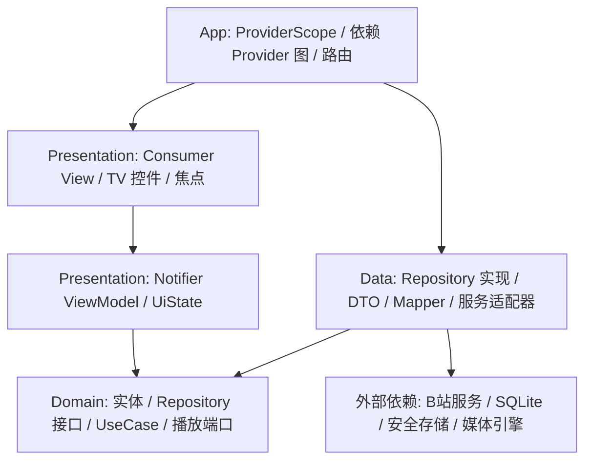

# MambaTV：TV 端 B 站客户端设计原则与架构

日期：2026-10-24。状态：设计基线，尚未实施。

配套执行文档：[详细开发计划](development-plan.md)。

## 1. 目标与当前基础

使用 Flutter + Riverpod + MVVM + 整洁架构，开发面向 Android TV／安卓电视盒子的第三方 B 站客户端。核心体验是：坐在电视前，仅使用方向键、确认键、返回键，就能找视频、登录、播放和继续观看。

本次检查得到的现状：

| 项目 | 当前证据 |
| --- | --- |
| 应用代码 | `lib/main.dart` 为 Flutter 计数器模板；`test/widget_test.dart` 为模板测试 |
| 平台 | 存在 Android、Windows 工程；Windows 只作为开发辅助平台 |
| 工具链 | 本机命令返回 Flutter 3.47.5、Dart 3.13.4；Flutter channel 显示为 `[user-branch]`，不能直接称作稳定频道 |
| 依赖 | 除 Flutter 外，运行时仅声明 `cupertino_icons`，业务依赖尚未安装 |
| Android | 包名为 `com.example.mambatv`，未配置 TV 启动入口、banner 和非触屏声明；主 Manifest 未声明联网权限 |
| 发布 | release 构建仍使用模板中的 debug 签名配置 |
| 版本管理 | 当前目录及父目录未识别到 Git 仓库 |
| 验证 | 本次仅检查源码、工具版本和资料，未运行应用、测试、APK 构建或电视设备验证 |

优先目标平台为 Android TV。最低 Android 版本和 ABI 在 M0 根据 Flutter、插件约束与实际目标设备共同确定；不提前承诺兼容所有旧盒子。保留现有 Windows 工程，但 Windows 播放或键盘测试通过不作为 TV 验收证据。

## 2. 产品范围

### v0.1.0：日常观看版本

- 游客浏览已验证可用的热门内容、搜索和普通 UGC 视频。
- 扫码登录、启动时恢复会话、登录失效提示、退出登录。
- 首页推荐／热门、视频搜索、视频详情、分 P 与相关视频。
- 普通视频播放、暂停、快进快退、清晰度与倍速选择、选集、自动续播。
- 本地观看记录与断点续播；登录后的收藏夹、稍后再看、远端历史读取。
- 添加／移除收藏和稍后再看；提供独立、明确的用户操作。
- 基础设置、网络失败重试、不可播放内容提示。
- 所有核心流程支持完整遥控器操作。

推荐、远端历史和清晰度的实际可用范围，以账号权限、接口验证和设备能力为准。不能将“获取到地址”视为“已经可以稳定播放”。

### v0.2.0：观看增强

- 字幕与基础弹幕，含关闭、大小、速度、密度和性能降级。
- UP 主视频列表与关注内容，扩展搜索筛选。
- 点赞、投币等交互按独立功能实现，投币需要明确数量与确认操作。

### 后续独立评估

直播、番剧／影视、评论浏览、投屏、离线下载、多账号切换、语音／手机辅助输入。番剧与直播使用独立内容模型和播放解析器，不能直接当作普通 UGC 的别名。

私信、发布动态、评论编辑与完整手机端功能对齐不属于首版目标。

## 3. 设计原则

1. **以遥控器任务为中心。** 每个可操作控件都有明确焦点；任何弹窗都有可返回的路径；不能依赖鼠标、触摸、长按或菜单键完成必要操作。
2. **先完成真实播放流程。** 优先验证登录、播放资源解析、音视频同步和硬解，再大规模开发页面。
3. **依赖指向领域层。** 领域模型与接口不依赖 Flutter、Dio、Drift、播放器插件或 Android API。
4. **页面只负责展示与 UI 行为。** 页面不解析 JSON、不签名请求、不持有凭据、不组织播放恢复业务。
5. **每类状态有明确所有者。** Repository 管理数据，播放会话管理播放过程，ViewModel 管理页面状态，View 管理焦点和动画。
6. **优先使用成熟库。** 复用网络、数据库、路由和媒体引擎；只实现项目需要的业务策略与适配层。
7. **按失败场景设计。** 区分网络故障、会话失效、限流、权限不足、资源失效和设备不支持，给出各自可执行的恢复方式。
8. **性能由目标设备验证。** 使用惰性列表、定尺寸图片和有限缓存；高频播放进度、弹幕刷新不触发整页重建。
9. **有依据地复用上游。** PiliPlus 用作协议和行为参考；引入代码前记录来源、版本、依赖及许可证。不整体搬运它的状态管理和页面。
10. **保持项目范围清晰。** 首版客户端直接连接经验证的服务，不引入自建转发后端、账号托管服务或云端同步系统。

## 4. 技术选型与决策状态

“确定”表示本项目选用方向，不表示已经安装或通过兼容性测试；确切版本在 M0／M1 解析依赖后锁定并提交 lockfile。

| 关注点 | 选择 | 状态与理由 |
| --- | --- | --- |
| UI | Flutter、Material 3 基础控件、独立 TV 组件 | 确定；深色大屏主题、统一间距与焦点样式 |
| MVVM | `flutter_riverpod` 的 `Notifier`／`AsyncNotifier` + 不可变 UiState | 确定；ViewModel 承担页面状态与命令，异步初始化使用 `AsyncValue` 表达 |
| 依赖注入 | Riverpod Provider 图 + 业务对象构造函数注入 | 确定；App 中的 Provider 绑定 Repository／UseCase，实现不接收 Ref |
| Riverpod 生成 | `riverpod_annotation` + `riverpod_generator`，复用 `build_runner` | 确定；集中处理声明与生成，具体兼容版本在 M0／M1 锁定 |
| 路由 | `go_router` | 确定；集中维护路由、登录回跳和页面作用域 |
| 网络 | `dio` | 确定；封装取消、超时、鉴权、限流和脱敏日志 |
| 领域数据 | 不可变 Dart 类型；复杂联合状态使用 `freezed` | 确定；避免把传输模型直接暴露给页面 |
| JSON | `json_serializable`，配合 `build_runner` | 确定；只放在数据层，处理缺失字段与兼容响应 |
| 结构化本地数据 | Drift / SQLite | 确定；历史、续播、缓存和迁移由 Repository 管理 |
| 简单设置 | `shared_preferences` 的异步接口 | 确定；仅保存可恢复的偏好，不能存账号秘密或关键观看进度 |
| 凭据 | `flutter_secure_storage` 封装的 CredentialStore | 确定；实际 Android 版本、备份恢复和设备兼容性在 M0 验证 |
| 播放 | `media_kit` + `media_kit_video` + `media_kit_libs_video` | 候选；必须通过 M0/M2 音视频分离、请求头和真机硬解验证 |
| 播放替代 | Android Media3 适配器 | 备选；仅在候选引擎关键能力失败后评估，不并行维护两套引擎 |
| 图片／二维码 | 成熟的缓存图片组件与二维码渲染组件 | M1 选定；限制解码尺寸，不自写图片缓存或二维码编码 |
| 测试 | `flutter_test`、`integration_test`、独立 ProviderContainer／ProviderScope overrides、手写 Fake | 确定；重点覆盖状态机、Provider 生命周期、请求竞态、焦点与真实播放 |

页面状态与依赖装配统一使用 Riverpod，不引入 `package:provider`、GetX 或 Bloc；新 ViewModel 使用 Notifier 系列，不采用 ChangeNotifierProvider 作为过渡。PiliPlus 当前依赖中存在播放器 Git 定制分支，不能假设官方 media_kit 与其行为完全一致；如果必须采用补丁分支，需要记录具体问题、固定提交及回归用例。

## 5. 分层与依赖方向



上图箭头表示编译期依赖。运行时，ViewModel 通过 App 的依赖 Provider 获得领域接口，调用装配入口提供的数据层实现，再访问网络、存储与媒体引擎。Provider 的接口契约使用领域类型，具体实现仅在 App 装配时绑定；领域层不会反向 import 数据层。

| 层 | 职责 | 禁止放入 |
| --- | --- | --- |
| Presentation / View | ConsumerWidget／ConsumerStatefulWidget、布局、焦点、动画、路由动作、按键映射 | HTTP、JSON 解析、SQL、凭据、播放地址解析 |
| Presentation / ViewModel | Notifier／AsyncNotifier、不可变页面状态、用户命令、并发请求协调、展示错误 | BuildContext、FocusNode、数据库实体、插件控制器 |
| Domain | 实体、业务规则、Repository 抽象、跨仓储 UseCase、播放端口 | Flutter、Riverpod／Ref、Dio、平台插件、Widget、具体存储类型 |
| Data | Repository 实现、DTO 映射、缓存策略、协议、持久化、引擎适配 | Riverpod／Ref、导航、弹窗、焦点控制、页面状态 |
| App | ProviderScope、依赖 Provider 图、创建并组合实现、路由、主题、生命周期转发 | 视频解析规则、通用业务大类 |

UseCase 按复杂度增加：`StartPlayback`、`RestorePlayback`、`RefreshSession` 等跨步骤业务需要独立用例；简单的读取列表允许 ViewModel 直接调用领域 Repository 接口，避免为每个方法增加无意义的透传类。

## 6. 建议目录

```text
lib/
  main.dart
  app/
    bootstrap.dart
    app.dart
    providers/
      infrastructure_providers.dart
      repository_providers.dart
      use_case_providers.dart
    router.dart
    lifecycle_bridge.dart
  core/                         # 仅纯 Dart 的通用基础，不存业务大类
    result.dart
    failure.dart
    clock.dart
    pagination.dart
  domain/
    entities/                   # Video、VideoPart、Session、PlaybackSource 等
    repositories/               # 各业务 Repository 抽象
    ports/                      # PlaybackEngine 等纯 Dart 端口
    use_cases/
      auth/
      playback/
      library/
    playback/                   # 播放会话状态与协调器
  data/
    models/                     # DTO、数据库记录与映射
    repositories/               # 领域接口的实现
    services/
      bilibili/                 # HTTP、协议、签名、会话、能力适配
      local/                    # Drift、偏好、安全存储封装
      playback/                 # 媒体引擎适配、播放事件转换
  ui/
    core/
      theme/
      widgets/                  # TvButton、TvVideoCard、TvGrid 等
      focus/                    # 焦点作用域、焦点恢复、按键策略
      playback/                 # 媒体画面宿主与渲染绑定
    features/
      shell/
      auth/
      home/
      search/
      video_detail/
      player/
      library/
      settings/
      # 每个功能内按 views/、view_models/、widgets/ 组织
      # ViewModel 的 Riverpod 声明与生成文件就近存放
test/
  domain/
  data/
  ui/
  fixtures/                     # 脱敏响应、合成数据
integration_test/
docs/
```

按实际实现逐步创建目录，不先堆满空文件。业务模块之间通过领域接口协作，禁止一个页面直接访问另一个页面的 ViewModel。

## 7. 领域模型、仓储与状态所有权

以下名称是本项目拟定义的内部抽象，不是 Flutter 插件或 B 站官方 API。

| 抽象 | 内容与职责 |
| --- | --- |
| `SessionRepository` | 唯一会话事实来源：游客／登录／失效、当前用户、会话代次；协调凭据恢复与失效 |
| `AuthRepository` | 创建扫码挑战、轮询、取消、结果交换和退出远端会话 |
| `DiscoveryRepository` | 推荐、热门；各自分页语义在数据层转换 |
| `SearchRepository` | 搜索与查询条件；响应绑定查询标识，丢弃过期结果 |
| `VideoRepository` | 视频详情、分 P、相关内容，保持视频标识与分段标识分离 |
| `PlaybackRepository` | 获取播放资源、有效清晰度／音轨／字幕、失效后重新解析 |
| `HistoryRepository` | 本地播放进度与观看列表；远端历史读取／上报作为独立能力 |
| `LibraryRepository` | 收藏夹、稍后再看、写操作；远端结果与本地缓存一致性 |
| `SettingsRepository` | 播放和界面偏好 |
| `PlaybackEngine` | 纯 Dart 播放命令、能力与事件；不返回 Widget 或插件对象 |

核心模型包括 `VideoId`、`VideoSummary`、`VideoDetail`、`VideoPart`、`PageSlice<T>`、`AuthState`、`QrChallenge`、`PlaybackSource`、`PlaybackSnapshot`、`WatchProgress`。领域对象不携带原始 JSON、Dio Response 或 Drift row。

- 分页统一表达 items、下一页标识、是否结束；不能假设所有接口都使用相同页码。
- 扫码挑战包含过期时间与本次挑战标识；重新生成后旧轮询结果不得改变会话。
- `PlaybackSource` 能表达独立音轨、视频候选、非敏感请求头策略、备用地址、有效期和可用能力；字段必须来自已验证的协议。敏感鉴权头通过数据层内部的短期资源句柄解析，不暴露给页面。
- 凭据只存在于 CredentialStore 和会话服务；页面只读取脱敏账号信息。播放请求如需敏感头，仅在数据层／媒体适配器内部短期传递，不写入 UiState、普通数据库或日志。
- `WatchProgress` 使用账号范围 + 视频标识 + 分 P 标识定位，包含位置、时长、更新时间、完成状态和数据来源。

### Riverpod 与 MVVM 的对应关系

| 用途 | 本项目约定 |
| --- | --- |
| 有本地 UI 状态和用户命令 | `Notifier<UiState>`，例如播放器控制状态、搜索编辑状态 |
| 需要异步初始化和后续用户命令 | `AsyncNotifier<UiState>`，例如首页、详情和个人列表；命名保持 `HomeViewModel` 等业务语义 |
| 只读异步或事件投影 | 按需要使用 FutureProvider／StreamProvider，例如会话只读快照；不重复创建一份业务事实来源 |
| 依赖提供 | App 内的 Provider 返回领域接口，创建 Service、Repository 和 UseCase 时使用构造函数注入 |
| View | ConsumerWidget，需管理焦点／滚动控制器时使用 ConsumerStatefulWidget；用 `ref.watch` 订阅展示数据、`ref.read` 调用命令 |
| 导航与一次性 UI 效果 | View／App 通过 `ref.listen` 接收效果并消费，不能因 Widget 重建重复导航或提交账号操作 |

Provider 声明采用 Riverpod 代码生成方式，运行时使用 `flutter_riverpod` 与 `riverpod_annotation`，生成器为开发依赖。文档按 Riverpod 3 的现行机制规划，精确版本和与其他生成器的兼容性在 M0／M1 验证。领域层和数据层不导入 Riverpod，Ref 只存在于 App 装配与 Presentation。

### ViewModel 约定

- 页面状态使用不可变 UiState；Notifier 更新 state，不能原地修改列表或沿用可变 ChangeNotifier 设计。
- 异步初始加载与失败使用 AsyncValue；UiState 内独立描述刷新、分页、局部写操作和保留旧内容时的错误，不能分页一次就清空整页。
- 同一路由可重复入栈时，以稳定页面实例 ID 与内容 ID 参数化 ViewModel；账号相关查询再包含 ownerKey／账号代次。同参数 Provider 会共享状态，不能仅使用视频 ID 就假设每个页面实例独立。
- 仅把声明式读取与可重复初始化放在 Notifier／AsyncNotifier 的 `build`；禁止在 Widget 的 `build` 发请求，也禁止在 Provider 构建中隐式提交收藏、投币、扫码挑战创建或媒体打开等用户动作。
- Command 暴露执行中、可执行条件和结果；写操作提交期间禁用重复操作；Provider 重算不能重放一次性用户命令。
- 异步返回校验请求代次、账号代次和 Ref 生命周期；必要时使用 `ref.onDispose` 清理请求、计时器、订阅，自动释放不会自行取消底层网络任务。
- 高频进度订阅局部化，通过细粒度 Provider／`select` 只刷新需要的控件，播放时钟不能导致整页重建。
- ViewModel 不直接依赖其他页面 ViewModel；共享会话、播放会话与缓存仍通过领域服务／仓储协作。

### 生命周期

应用根部建立 ProviderScope，应用级依赖 Provider 持有会话、Repository、数据库、网络服务与设置，显式配置 `keepAlive`；这不等于立即初始化，启动恢复由 App 根部主动订阅／bootstrap 触发。SessionRepository 仍是唯一会话事实来源，Riverpod 负责暴露和监听其状态。

生成的页面级 Provider 默认自动释放；对需要保存返回位置的主页／分页数据，使用明确的保留策略和 Repository 缓存，不把所有 Provider 永久保活。页面不可见、路由退出、应用后台和 Provider dispose 分开处理：隐藏页面可能仍在路由栈中，不能只靠无监听或自动释放停止扫码轮询。Riverpod 3 的不可见 Consumer 订阅暂停行为也不能替代业务生命周期命令；关键会话／播放状态由明确的应用或播放会话订阅维持。

FocusNode、滚动控制器属于页面 View。播放页面创建一个播放会话，首版同时最多一个活动媒体引擎，Provider 只持有该会话／工厂的引用；不能因依赖变化或 build 重算意外重新打开媒体。正常退出先显式完成保存进度和关闭，再离开；`ref.onDispose` 仅作取消订阅等兜底清理，不依赖其完成异步写入，也不在回调中修改其他 Provider。未来小窗／后台播放需要新的生命周期设计。

退出账号按顺序停止旧任务、保存并关闭播放、清除凭据／私人缓存、更新账号代次，再使相关 Provider 失效；仍被监听的 Provider 失效后可能重建，必须先确保其读取的是游客／新账号状态。不能把 `ref.invalidate` 当作完整退出登录流程。

Flutter `FocusNode` 由 View／UI 控制器创建释放；ViewModel 可以保存纯数据的焦点项 ID，但不能持有节点。媒体画面由 `ui/core/playback` 宿主接入，插件类型局限在该绑定和引擎适配器；通过 App 工厂组合画面和同一个会话引擎，不把插件控制器传进领域层。

## 8. TV 信息架构与交互规则

首版采用左侧导航 + 内容区：主页、搜索、我的、设置；登录作为可回跳的独立页面，视频详情与播放器作为独立路由。主页保留推荐／热门切换；登录失效时仍允许使用可用的游客功能。

### 页面构成

| 页面 | 主要内容 | 默认焦点 |
| --- | --- | --- |
| 首页 | 导航、推荐／热门、视频卡片 | 恢复上次卡片；首次进入落在首个可用内容 |
| 搜索 | 输入框、搜索键、历史、结果网格 | 首次输入框；返回时恢复结果卡片 |
| 登录 | 二维码、有效期、轮询状态、刷新／取消 | 刷新或取消按钮；状态变更不随意抢焦点 |
| 详情 | 标题、UP 信息、播放、分 P、收藏、相关视频 | 播放／继续播放 |
| 播放 | 画面、控制条、清晰度／倍速／选集弹层 | 画面操作区；开启弹层后进入弹层 |
| 我的 | 本地记录、远端历史、收藏夹、稍后再看 | 上次页签与内容；未登录时提供登录入口 |
| 设置 | 播放偏好、界面、缓存、账号、关于 | 当前设置项 |

### 焦点与按键

- 每个页面划分导航区、内容区、弹层区；跨区域移动制定明确规则，区内使用 Flutter 焦点遍历能力。
- 焦点恢复键使用稳定内容 ID，辅以滚动位置和索引；列表变化导致项消失时回退到邻近可用项。
- 长列表仅创建可见项及有限预取项，不能为全部分页内容永久保留 FocusNode。
- 弹层打开时限制焦点在弹层，关闭后恢复触发按钮；页面加载、空结果、错误状态都至少有一个可操作焦点。
- 只允许当前操作区域消费按键，防止播放器和底层列表同时响应；确认键按下一次只提交一次动作。
- 按键长按仅用于可选的连续快进；按键抬起、焦点丢失和应用暂停都应清理重复状态。
- 返回顺序：关闭弹层 → 关闭控制条 → 退出播放／详情 → 回到上一页面；根页面使用明确的退出确认，Home 键交给系统。
- 不将菜单键、媒体键、鼠标或语音作为必要条件；支持时可提供额外快捷操作。
- 中文输入第一版调用系统输入法，并验证输入法关闭后焦点恢复；手机扫码输入列为后续增强。

### 视觉基线

深色背景、清晰对比、16:9 视频卡片、可远距离阅读的字号。焦点使用边框／背景／轻微缩放组合，不能只靠颜色。以逻辑尺寸和布局断点适配窗口，实测 720p、1080p 和 4K 输出；限制卡片尺寸与每行数量，不以物理分辨率直接乘大字号。预留可调整边缘安全区，不做全屏高成本模糊。

## 9. 登录、接口与错误处理

### 接口证据原则

PiliPlus 的 `lib/http/login.dart`、`video.dart` 等能提供实现线索，但不是官方稳定性承诺。扫码协议、请求签名、会话刷新与资源解析，必须先选定一致的接口体系并实测。

M0 为每项能力建立记录：来源链接和固定提交、验证日期、方法与地址、请求／响应结构、账号条件、凭据形式、签名与必要头、分页、错误语义、脱敏样本和验证设备。未经记录的端点不能进入生产适配器。本文不预填未经验证的 B 站端点、密钥或错误码。

### 扫码登录流程

创建挑战 → 显示二维码 → 按验证过的间隔轮询 → 等待扫描／确认 → 获得凭据 → 获取当前用户并校验 → 成功持久化 → 发布已登录状态 → 回到原目标。

轮询不能重叠；过期、取消、页面销毁、切到后台均停止。返回前台后先校验挑战是否过期，再恢复或允许重新生成。启动恢复在安全存储读取后验证会话，不能仅凭“存在 Cookie”判断登录成功。网络故障与凭据失效分开处理，不因为一次超时就清除会话。

会话刷新使用 single-flight：并发请求只触发一次刷新，并且限制重放次数。若选定协议没有经验证的刷新能力，明确转为重新扫码，不能猜测刷新 API。退出时取消旧请求、停止当前账号播放和轮询、清空内存会话及凭据，增加账号代次，防止迟到响应恢复旧状态。

### 网络策略

- 分离元数据客户端和媒体访问配置。按目标域名、协议和账号范围添加最小请求头；跳转到 CDN 不自动转发全部账号凭据。
- 业务错误映射为本项目 `Failure`：network、timeout、authExpired、permissionDenied、rateLimited、contentUnavailable、unsupportedMedia、contractChanged、cancelled、unknown。
- 只有只读且可安全重放的请求进行有限退避重试；尊重服务限流提示。取消不显示为故障，限流不进行高频重试。
- Riverpod 3 存在 Provider 构建失败自动重试机制；本项目在根 ProviderScope 显式关闭该重试，由数据层统一管理允许重试的只读请求，播放恢复由播放协调器管理。避免 Provider、Dio 和业务层叠加重试；写命令不放入可重算构建。参见 [Riverpod 重试机制](https://riverpod.dev/docs/concepts2/retry)。
- 收藏、投币等写请求不盲目重试。响应丢失时先查询最终状态，或给出待确认结果；能恢复时才提交新的动作。
- 请求日志仅记录能力名、耗时、状态类别和脱敏关联 ID，不记录 Cookie、令牌、完整签名参数、二维码挑战或可播放链接。
- DTO 映射发现关键字段不兼容时返回明确错误；可选字段缺失允许降级，不能把异常伪装为空列表。

## 10. 播放架构与恢复策略

播放链路：详情页选择视频／分 P → `StartPlayback` → 验证当前账号能力 → 读取本地进度 → 解析资源 → 引擎打开音视频 → 等待准备完成 → 应用合法续播位置 → 播放 → 周期保存进度 → 返回并释放。

### 状态与并发

基础状态：idle、resolving、opening、playing、paused、buffering、ended、failed、disposed；切清晰度、seek 和恢复是受协调器串行管理的操作。明确 `desiredPlaying` 与引擎当前状态，恢复资源时保持用户先前的暂停意图。

每次打开视频、换分 P 或重新解析都会产生新的播放代次；命令与事件携带会话／代次，丢弃旧事件。快速连续选集、seek 与切清晰度不能相互覆盖。重复释放要安全，销毁后不能再处理引擎事件。

### 必须验证的能力

- 独立视频与音轨的同步打开、拖动与切换；不能以静音视频播放成功判定通过。
- 视频、外部音轨、分段请求、备用 CDN 各自所需请求头；视频可取不代表音轨可取。
- 仅展示当前账号和设备实际可用的清晰度、编码、音轨；不承诺会员或区域权限外的播放。
- 清晰度切换保存位置、音量、倍速、暂停状态，重新打开并在准备后恢复；允许有明确加载反馈，不承诺无缝切换。
- 首版优先验证 H.264 + AAC 的普通 UGC；HEVC、AV1、高帧率和 HDR 逐项记录设备结果，不能假设所有硬件支持。
- 资源失效后限次重新解析，再恢复位置；鉴权、权限和解码错误不能共用无限重连逻辑。
- 编码不支持时提供已验证的低兼容性要求方案，例如另一可用编码／清晰度；软件解码只能作为实测可行的选项。
- 用户离开应用、系统音频焦点丢失、设备休眠时保存进度并暂停；回前台不擅自播放，按原状态提供恢复。

### 进度与媒体渲染

本地进度在正常播放时暂按 5 秒节流写入，暂停、换集和退出时立即提交最新快照；时间间隔是本项目初始策略，可经测试调整。进程强杀可能丢失最近一个写入周期，不能依赖退出回调保证零丢失。续播时夹紧至有效时长，已完成视频和接近片尾时提供重播／下一 P。

只有准备成功、定位完成且未被新会话替代的进度才可写入，防止初始化阶段的 0 覆盖有效记录。远端心跳按接口验证得到的规则独立调度，不能照搬本地 5 秒间隔；远端失败不影响本地续播和视频播放。

播放画面、控制条进度、后续弹幕／字幕分别监听各自事件。M8 以后弹幕／字幕统一使用媒体时间轴，在 seek、暂停、变速和换源时重置，不能以独立 Timer 充当真实播放时钟。

## 11. 本地数据与账号隔离

| 存储 | 数据 | 策略 |
| --- | --- | --- |
| 安全存储 | 账号凭据、刷新材料 | 不进入 SQLite、普通偏好、源码、测试样本或日志；备份策略按插件和 Android 配置验证 |
| Drift | 本地观看进度、观看记录、搜索历史、元数据／收藏缓存 | 事务写入、schema 版本、迁移测试、容量和过期清理 |
| 简单偏好 | 默认倍速、首选画质、字幕／弹幕偏好、主题／安全区 | 可恢复的简单配置 |
| 内存 | 页面快照、播放资源、临时会话状态 | 限量、短期；账号退出或内容切换时释放 |
| 图片磁盘缓存 | 公共封面等 | 尺寸／容量限制，提供清理入口 |

游客与账号数据使用不同 ownerKey。游客记录默认保留在游客范围，不自动上传；是否合并由后续明确的产品行为决定。账号退出后清除该账号私人列表缓存与搜索记录，保留的本地续播数据必须按账号隔离并提供清理入口，游客不能读取。重新登录其他账号时，不复用上一账号页面快照或请求结果。

本地进度是本设备续播的默认来源；远端历史单独展示。没有本地记录时才在已验证语义下使用远端位置，不以一个不可靠时间戳无条件覆盖本地记录。服务器收藏与稍后再看是账号列表事实来源，本地仅缓存；离线时不悄悄排队执行账号写操作。

## 12. 可验证性与完成定义

- 领域测试覆盖播放代次、状态迁移、过期资源恢复、续播保护和完成判定。
- 数据测试覆盖脱敏契约样本、会话刷新并发、账号隔离、分页、迁移和写操作结果不确定场景。
- ViewModel／Provider 测试为每个用例创建独立 ProviderContainer，通过 overrides 注入 Fake Repository、时钟和播放适配；自动释放 Provider 在测试期间保持监听，结束后清理。覆盖依赖失效、迟到结果、释放取消、账号代次与关闭自动重试的效果。
- Widget 测试用键盘事件验证焦点、区域移动、弹层返回、列表恢复和加载／错误状态。
- Widget 测试使用独立 ProviderScope overrides，不连接真实账号或共享全局容器；领域／数据单元测试继续通过构造函数注入，不需要 Riverpod 容器。
- 集成测试覆盖游客找片、扫码后的账号流程、播放返回与续播；真账号测试为受控人工／本机流程，不能依赖公开 CI 保存 Cookie。
- TV 模拟器用于界面和按键，至少一台真实目标设备用于硬解、音视频同步、休眠恢复和长时间播放。
- `flutter analyze`、必要代码生成、自动测试、release APK 构建、真机验收分别记录；前一项通过不能替代后一项。

当前所有上述业务能力均为计划项。后续阶段任务、时间估算、设备矩阵和量化验收见开发计划。

## 13. 资料与依据

资料查阅日期为 2026-10-24。官方指南提供框架机制和推荐，本项目分层、范围、状态机及里程碑属于项目设计决策。

- [Flutter 应用架构指南](https://docs.flutter.dev/app-architecture/guide)：View、ViewModel、Repository、Service 的职责。
- [Flutter 架构建议](https://docs.flutter.dev/app-architecture/recommendations)：分离职责、依赖注入、测试与条件使用领域用例。
- [Flutter 焦点系统](https://docs.flutter.dev/ui/interactivity/focus)：焦点生命周期和遍历。
- [Android TV 项目配置](https://developer.android.com/training/tv/get-started/create)：TV 启动入口、banner 与非触屏要求。
- [Android TV 遥控器](https://developer.android.com/training/tv/get-started/controllers)：D-pad 和遥控器连接变化。
- [Riverpod Provider 类型](https://riverpod.dev/docs/concepts2/providers)、[自动释放](https://riverpod.dev/docs/concepts2/auto_dispose)、[代码生成](https://riverpod.dev/docs/concepts/about_code_generation)、[Provider 测试](https://riverpod.dev/docs/how_to/testing)、[Riverpod 3 行为变化](https://riverpod.dev/docs/whats_new)：状态、装配与生命周期依据。
- [go_router](https://pub.dev/packages/go_router)、[Dio](https://pub.dev/packages/dio)：路由和网络选型资料。
- [media_kit](https://pub.dev/packages/media_kit)：媒体引擎、渲染与原生库拆分，以及外部音轨和请求头能力；具体 B 站链路仍需验证。
- [Drift](https://drift.simonbinder.eu/)、[shared_preferences](https://pub.dev/packages/shared_preferences)、[flutter_secure_storage](https://pub.dev/packages/flutter_secure_storage)：持久化职责与平台配置资料。
- [PiliPlus](https://github.com/bggRGjQaUbCoE/PiliPlus)、[依赖](https://github.com/bggRGjQaUbCoE/PiliPlus/blob/main/pubspec.yaml)、[登录实现](https://github.com/bggRGjQaUbCoE/PiliPlus/blob/main/lib/http/login.dart)、[视频实现](https://github.com/bggRGjQaUbCoE/PiliPlus/blob/main/lib/http/video.dart)、[许可证原文](https://github.com/bggRGjQaUbCoE/PiliPlus/blob/main/LICENSE)：上游参考，后续实际复用时固定提交。
